# گزارش آزمایش دوم: عدد نویز و پارامترهای RF

گروه: سروش مومنی (402102538) و مهدی قلمی نوبر (402102284)
مدرس: دکتر سید محمد کرباسی — نیمسال اول ۱۴۰۵–۱۴۰۶

## چکیده و نتایج اصلی

در این آزمایش، رفتار نویزی و خطی‌بودن گیرندهٔ ADALM-PLUTO در فرکانس مرکزی `434 MHz` و پاسخ فرکانسی پیوند آنتنی در بازهٔ `400–3000 MHz` بررسی شد. توان نویز از نوار `400 kHz`، توان تن‌ها و مؤلفه‌های جانبی از نوارسنج‌های `10 kHz` و پاسخ آنتن از فایل CSV استخراج شد. مبنای تحلیل، مقادیر عددی ثبت‌شده در جلسه است [۱].

در بهرهٔ `40.2 dB`، با ENR اسمی `15 dB`، روش Y-Factor مقدار تقریبی `NF = 19.41 dB` را می‌دهد. برآورد مستقیم در همان بهره و با ضریب تبدیل دستورکار، `23.73 dB` است. جاروب تک‌تن در بازهٔ بررسی‌شده به معیار افت بهرهٔ یک دسی‌بل نرسید. در آزمون دو‌تن، اختلاف تن اصلی و مؤلفهٔ جانبی حدود `46.03 dB` و شیب مؤلفه‌های جانبی نزدیک یک بود. بیشینهٔ پاسخ آنتنی در `1660 MHz` و پهنای باند سه‌دسی‌بلی پیوند حدود `113.5 MHz` به دست آمد.

| کمیت | نتیجه | مرجع و تفسیر |
| --- | --- | --- |
| عدد نویز در بهرهٔ `40.2` | `19.41 dB` | Y-Factor؛ ENR اسمی `15 dB` |
| عدد نویز مستقیم در بهرهٔ `40.2` | `23.73 dB` | با `GFS = 20 dB` و `Bn = 400 kHz` |
| تراکم یک‌دسی‌بلی | بالاتر از انتهای جاروب | `P1dB > −80.5 dBm` روی محور ورودی اسمی دستورکار |
| تضعیف نسبی مؤلفهٔ جانبی | `46.03 dBc` | میانگین هشت سطح؛ شیب جانبی حدود `0.955 dB/dB` |
| قلهٔ پاسخ پیوند | `1660 MHz` | سطح ثبت‌شده: `−28.10 dB relative` |
| باند سه‌دسی‌بلی پیوند | `1605.6–1719.1 MHz` | پهنای باند `113.5 MHz`؛ درون‌یابی خطی |

خلاصهٔ نتایج. توان‌های ورودی حاصل از رابطهٔ فرستنده با عنوان «اسمی» مشخص شده‌اند.

## هدف، چیدمان و مبنای اندازه‌گیری

هدف، تعیین ارتباط بین بهره، کف نویز، پاسخ تک‌تن و رشد مؤلفه‌های بین‌مدولاسیون، و سپس استخراج باند پاسخ آنتنی بود. مطابق دستورکار، در آزمون‌های کابلی، فرستنده نقش منبع نویز یا سیگنال آزمون و گیرنده نقش دستگاه تحت آزمون را دارد. مسیر اتصال مرجع شامل تضعیف‌گر ثابت `30 dB` است. در بخش آنتن، ارتباط از طریق آنتن فرستنده و آنتن گیرنده برقرار می‌شود [۱، ص. ۱–۳ و ۷–۸].

| پارامتر | مقدار یا مبنا |
| --- | --- |
| فرکانس مرکزی آزمون‌های RF | `434 MHz`؛ قابل مشاهده در `Part4_topDiagram.png` |
| بهره‌های اندازه‌گیری نویز | `29.7, 40.2, 49.6 dB`؛ مطابق نام تصاویر |
| بهرهٔ آزمون دو‌تن | `40.2 dB`؛ در تصویر تنظیمات |
| بهرهٔ مرجع تحلیل تک‌تن | `40.2 dB` مطابق بخش ۳ دستورکار؛ جدول XLSX مقدار بهره را جداگانه ذخیره نکرده است |
| تن‌های مرجع | `f1 = fc + 300 kHz` و `f2 = fc + 400 kHz`؛ فاصلهٔ `100 kHz` |
| نوار نویز و نوار تن | به‌ترتیب `400 kHz` و `10 kHz`؛ طبق عنوان نوارسنج‌ها |
| نمای طیفی گیرنده | FFT برابر `4096`، پنجرهٔ `Blackman–Harris`؛ طبق تصاویر |
| منبع نویز | تنظیم پیش‌فرض اعلام‌شدهٔ جلسه: `tx_atten = 58.5 dB`؛ ENR اسمی تقریباً `15 dB` |
| جاروب تک‌تن | ۱۰ ردیف در `P1db.xlsx`، تضعیف‌های `60` تا `45 dB` |
| جاروب دو‌تن | ۸ ثبت در تضعیف‌های `65, 63, …, 51 dB` |
| جاروب آنتن | ۱۳۱ نقطه با گام `20 MHz`؛ تضعیف TX برابر `50 dB` و بهرهٔ RX برابر `20 dB` در تصویر رابط |

تنظیمات و منشأ آن‌ها. تنظیم پیش‌فرض نویز با توضیح گروه همراه داده‌ها تکمیل شده است.

سه مرجع سطح در تحلیل تفکیک می‌شوند: توان خروجی دیجیتال با واحد dBFS، تضعیف فرستنده با واحد dB، و برآورد توان ورودی با واحد dBm. ضریب `GFS = 20 dB` برای محاسبهٔ مستقیم نویز از دستورکار گرفته می‌شود. رابطهٔ زیر نیز محور اسمی ورودی فرستنده را می‌سازد. ثابت تبدیل فرستنده و ضریب کالیبراسیون گیرنده دو کمیت مستقل‌اند و به‌جای یکدیگر استفاده نمی‌شوند.

```text
Pinput,nom [dBm] = −35.5 − ATX [dB]
```

در فایل XLSX، ستون Attenuation با علامت منفی ذخیره شده است؛ برای مثال مقدار `−60` به معنی اندازهٔ تضعیف `60 dB` تفسیر می‌شود. در تصاویر دو‌تن، عدد نام فایل مبنای مرتب‌سازی سطح‌هاست. ثبت جداگانهٔ `Part4_topDiagram.png` تضعیف `65.5 dB` را نشان می‌دهد و به ردیف `65 dB` ادغام نشده است.

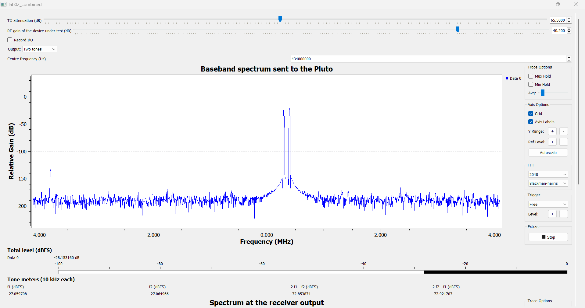

## روابط مورد استفاده

ضریب نویز، افت نسبت سیگنال به نویز در گیرنده را بیان می‌کند. برای دمای مرجع `T0 ≈ 290 K`، چگالی نویز حرارتی حدود `−174 dBm/Hz` در نظر گرفته می‌شود. برآورد مستقیم به تبدیل مطلق سطح دیجیتال به ورودی و پهنای باند معادل نویز وابسته است [۱، ص. ۴–۵].

```text
F = SNRin / SNRout     ;     NF = 10 log10(F)
```

```text
NFdirect ≈ Nopen − GFS − 10 log10(Bn / 1 Hz) + 174
```

در روش Y-Factor، نسبت توان در دو حالت روشن و خاموش محاسبه می‌شود. بهره و پهنای باند مشترک از نسبت حذف می‌شوند. ENR باید به صفحهٔ ورودی گیرنده ارجاع شود؛ اگر تلفات مسیر در ENR مؤثر لحاظ شده باشد، دوباره از آن کسر نمی‌شود [۱،۲].

```text
YdB = Non − Noff     ;     Y = 10^(YdB / 10)
```

```text
NFY = ENReff − 10 log10(Y − 1)
```

برای نقطهٔ تراکم، ابتدا خط مرجع با شیب واحد از ناحیهٔ سیگنال کوچک ساخته می‌شود. نقطهٔ P1dB جایی است که خروجی واقعی یک دسی‌بل زیر این خط قرار گیرد. در مدل غیرخطی مکعبی، شیب توان تن اصلی یک و شیب محصولات مرتبهٔ سوم سه است؛ رابطهٔ تقاطع فقط پس از بررسی این رفتار به کار می‌رود [۱،۳].

```text
C = Pout − Pin,nom     ;     D = (Pin,nom + C0) − Pout
```

```text
D(P1dB) = 1 dB     ;     IIP3 = Pin,per-tone + Δ / 2
```

در تمام محاسباتی که میانگین دو توان لازم بوده، ابتدا توان‌های خطی میانگین‌گیری شده و سپس نتیجه به دسی‌بل تبدیل شده است. اعداد گزارش برای خوانایی گرد شده‌اند؛ فایل دادهٔ استخراج‌شده مقادیر نمایشگرها را با دقت اصلی نگه می‌دارد.

```text
Pmean [dB] = 10 log10((10^(P1/10) + 10^(P2/10)) / 2)
```

## بخش اول: نویز گیرنده و برآورد مستقیم

در بخش اول، توان نوار `400 kHz` با ورودی باز خوانده شد. ستون اول جدول زیر مستقیماً از نوارسنج پایین تصاویر Part1 گرفته شده است؛ از ارتفاع تقریبی نمودار FFT برای محاسبه استفاده نشده است.

| بهرهٔ RX (dB) | Nopen (dBFS) | NF با GFS=20 (dB) | NF با اصلاح بهره (dB) |
| --- | --- | --- | --- |
| `29.7` | `-73.364` | `24.62` | `35.12` |
| `40.2` | `-74.248` | `23.73` | `23.73` |
| `49.6` | `-66.232` | `31.75` | `22.35` |

نتایج مستقیم. ستون سوم محاسبهٔ آموزشی با GFS ثابت است. ستون چهارم به مدل تغییر یک‌به‌یک GFS با بهره وابسته است.

```text
10 log10(400000) = 56.0206 dB     ;     NFdirect = Nopen + 97.9794
```

برای بهرهٔ مرجع `40.2 dB`، مقدار ورودی‌ارجاع نویز `−94.25 dBm` و عدد نویز مستقیم `23.73 dB` به دست می‌آید. چون GFS با بهره تغییر می‌کند، استفاده از مقدار ثابت ۲۰ برای هر سه تنظیم، مقایسهٔ مستقل از بهره ایجاد نمی‌کند. برای بررسی روند، ستون آخر بر مبنای مدل زیر محاسبه شده است. این ستون یک برآورد مبتنی بر مدل کالیبراسیون است و از اندازه‌گیری تازهٔ GFS حاصل نشده است.

```text
GFS(g) = 20 + (g − 40.2)
```

با این مدل، NF مستقیم از `35.12 dB` در بهرهٔ ۲۹٫۷ به `22.35 dB` در بهرهٔ ۴۹٫۶ کاهش می‌یابد. این روند با کاهش سهم نسبی نویز طبقات بعدی و مبدل هنگام افزایش بهرهٔ پیشین سازگار است. در اندازه‌گیری با ورودی باز، شرط مرجع نویز دقیقاً مانند یک بار تطبیق‌شدهٔ ۵۰ اهم نیست؛ بنابراین نتیجه با عنوان «برآورد مستقیم» گزارش می‌شود.

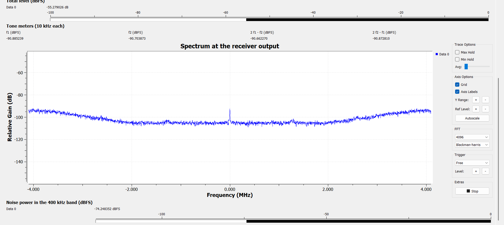

## بخش دوم: Y-Factor و مقایسهٔ روش‌ها

برای هر بهره، دو تصویر Part2 با پسوندهای on و off جفت شده‌اند. Noff این بخش از تصویر Part2 گرفته می‌شود؛ توان ورودی باز Part1 جایگزین آن نشده است. تنظیم پیش‌فرض نویز، `ENReff ≈ 15 dB` در ورودی مرجع را مشخص می‌کند.

| بهره (dB) | Noff (dBFS) | Non (dBFS) | YdB (dB) | Y خطی | تفسیر NF با ENR=15 |
| --- | --- | --- | --- | --- | --- |
| `29.7` | `-72.308` | `-49.186` | `23.121` | `205.187` | پاسخ سطح نویز؛ خارج از دامنهٔ این مدل ENR |
| `40.2` | `-67.707` | `-66.364` | `1.343` | `1.362` | `19.41 dB`؛ برآورد اسمی |
| `49.6` | `-58.961` | `-30.582` | `28.378` | `688.395` | پاسخ سطح نویز؛ خارج از دامنهٔ این مدل ENR |

خوانش‌های روشن/خاموش و نسبت Y. دامنهٔ مدل با فرض منبع مرجع و NF نامنفی بررسی شده است.

در بهرهٔ ۴۰٫۲، محاسبه به صورت زیر است:

```text
YdB = −66.363701 − (−67.706673) = 1.342972 dB
```

```text
Y = 1.362377     ;     NFY = 15 − 10 log10(0.362377) = 19.4084 dB
```

برای دو بهرهٔ دیگر، نسبت ثبت‌شده از سقف مدل مرجع بیشتر است. در مدل متعارف با دمای خاموش برابر T0 و `NF ≥ 0`، بیشینهٔ Y برای ENR برابر ۱۵ دسی‌بل حدود `15.14 dB` است. در نتیجه، ردیف‌های `23.12` و `28.38 dB` افزایش سطح نویز را نشان می‌دهند، اما با همین ENR به عدد نویز مطلق گیرنده تبدیل نمی‌شوند. روابط پارامتری این دو ردیف در زیر حفظ شده‌اند تا در صورت تعیین ENR مؤثر هر ثبت، مستقیماً قابل استفاده باشند. این تفکیک، پاسخ اندازه‌گیری‌شده را از انتساب آن به مدل منبع جدا می‌کند.

```text
Ymax = 1 + 10^(15/10) = 32.6228     ;     Ymax,dB = 15.1352 dB
```

```text
NF29.7 = ENReff,29.7 − 23.1003     ;     NF49.6 = ENReff,49.6 − 28.3721
```

ENR در محاسبات اصلی مطابق مثال دستورکار به ۱۵ دسی‌بل گرد شده است. اگر رابطهٔ گرد‌شدهٔ `ENR = 73.4 − tx_atten` عیناً استفاده شود، تنظیم `58.5 dB` مقدار `14.9 dB` می‌دهد و NF محاسبه‌شده نیز `0.1 dB` کمتر، یعنی حدود `19.31 dB` خواهد بود. این تفاوت، حساسیت مستقیم NF به مرجع اسمی منبع را نشان می‌دهد.

اختلاف دو روش در بهرهٔ مرجع `23.73 − 19.41 = 4.32 dB` است. روش مستقیم به GFS، پهنای باند معادل و شرایط ورودی باز حساس است. روش Y-Factor به ENR مؤثر و یکسان‌بودن شرایط خواندن دو حالت وابسته است. همچنین Noff بخش دوم در همین بهره `6.54 dB` بالاتر از توان ورودی باز بخش اول است؛ بنابراین این دو مقدار، اندازه‌گیری یک حالت ورودی مشترک نیستند. اختلاف روش‌ها باید با این تفاوت مرجع و حساسیت‌های کالیبراسیون تفسیر شود، نه صرفاً با تفاضل ظاهری دو عدد.

| منبع تغییر | اثر کمی بر نتیجه |
| --- | --- |
| تغییر `+1 dB` در GFS | تغییر `−1 dB` در NF مستقیم |
| تغییر `+1 dB` در ENR مؤثر | تغییر `+1 dB` در NF روش Y-Factor |
| افزایش ۱۰٪ در Bn فرض‌شده | تغییر حدود `−0.414 dB` در NF مستقیم |
| خطای `+0.1 dB` در YdB در بهرهٔ ۴۰٫۲ | تغییر دقیق حدود `−0.365 dB` در NF |
| خطای `−0.1 dB` در YdB در بهرهٔ ۴۰٫۲ | تغییر دقیق حدود `+0.389 dB` در NF |
| اختلاف قرائت `0.1 dB` در هر یک از Non و Noff | اگر مستقل و با تعبیر انحراف معیار باشند: سهم NF حدود `0.53 dB` با تقریب مرتبهٔ اول |

تحلیل حساسیت. این جدول اثر اغتشاش‌های مشخص را نشان می‌دهد؛ جایگزین عدم قطعیت کالیبراسیون منبع نیست.

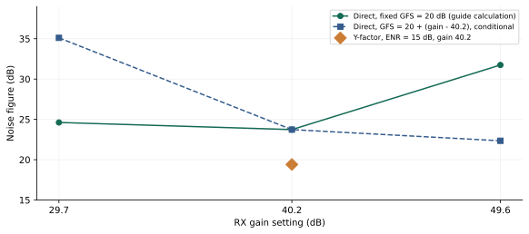

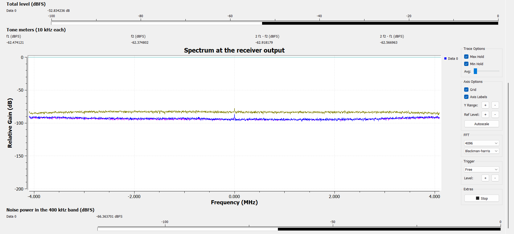

## بخش سوم: جاروب تک‌تن و P1dB

۱۰ زوج دادهٔ جدول XLSX، منبع اصلی منحنی تک‌تن است. خط مرجع با شیب یک و میانگین اختلاف سطح در سه نقطهٔ کم‌توان اول تعیین شد. از آنجا که خروجی dBFS و ورودی dBm اسمی است، C0 یک ضریب نگاشت سطح است؛ نباید با بهرهٔ توان آنالوگ یا مقدار تنظیم RF gain یکسان گرفته شود.

```text
C0 = mean(Pout − Pin,nom), first 3 points = 70.4333
```

| ATX (dB) | Pin اسمی (dBm) | Pout (dBFS) | C=Pout−Pin | افت نسبت به خط (dB) |
| --- | --- | --- | --- | --- |
| `60` | `-95.5` | `-25.0` | `70.50` | `-0.067` |
| `55` | `-90.5` | `-20.2` | `70.30` | `0.133` |
| `52` | `-87.5` | `-17.0` | `70.50` | `-0.067` |
| `51` | `-86.5` | `-16.4` | `70.10` | `0.333` |
| `50` | `-85.5` | `-15.5` | `70.00` | `0.433` |
| `49` | `-84.5` | `-14.1` | `70.40` | `0.033` |
| `48` | `-83.5` | `-13.6` | `69.90` | `0.533` |
| `47` | `-82.5` | `-12.3` | `70.20` | `0.233` |
| `46` | `-81.5` | `-11.2` | `70.30` | `0.133` |
| `45` | `-80.5` | `-10.2` | `70.30` | `0.133` |

جاروب تک‌تن و افت نسبت به خط سیگنال کوچک. مقدار منفی کوچک، بالاتر بودن همان قرائت از خط مرجع را نشان می‌دهد.

شیب برازش کل جاروب `0.982 dB/dB` است. بیشترین افت نسبت به خط مرجع `0.533 dB` و افت در بالاترین ورودی `0.133 dB` به دست آمد. افت یک‌دسی‌بلی در هیچ نقطهٔ ثبت‌شده دیده نمی‌شود. بنابراین نتیجهٔ آزمون به‌صورت ادامهٔ رفتار تقریباً خطی تا انتهای جاروب و کران زیر برای P1dB بیان می‌شود:

```text
P1dB > Pin,max,nom = −80.5 dBm     (ATX = 45 dB)
```

در بالاترین ورودی، خروجی `−10.2 dBFS` است؛ این مقدار سطح انتهای جاروب است و سطح خروجی در نقطهٔ تراکم محسوب نمی‌شود. از این ثبت می‌توان گفت که خروجی تن اصلی هنوز `10.2 dB` زیر مرجع تمام‌مقیاس است. تعیین اینکه نخست کدام طبقه محدودکننده می‌شود، به مشاهدهٔ خود نقطهٔ تراکم و سطح کل/قلهٔ سیگنال نیاز دارد؛ این نتیجه از سطح یک تن به‌تنهایی استنتاج نمی‌شود.

تصویر مستقل `Part3_60dB_attenuation.png` مقدار تن `−22.350 dBFS` را نشان می‌دهد، در حالی که ردیف متناظر جدول XLSX برابر `−25.0 dBFS` است. این دو ثبت مستقل‌اند؛ برای حفظ یکپارچگی جاروب، منحنی و برازش فقط از سری XLSX ساخته شده‌اند. تصویر به‌عنوان نمونهٔ طیفی همان بخش نگه داشته شده است.

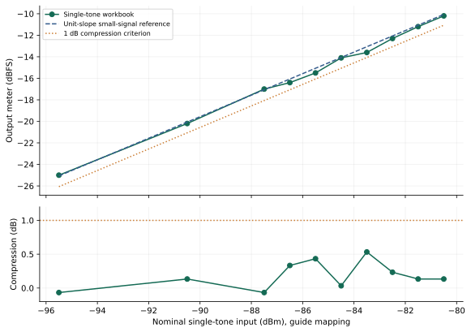

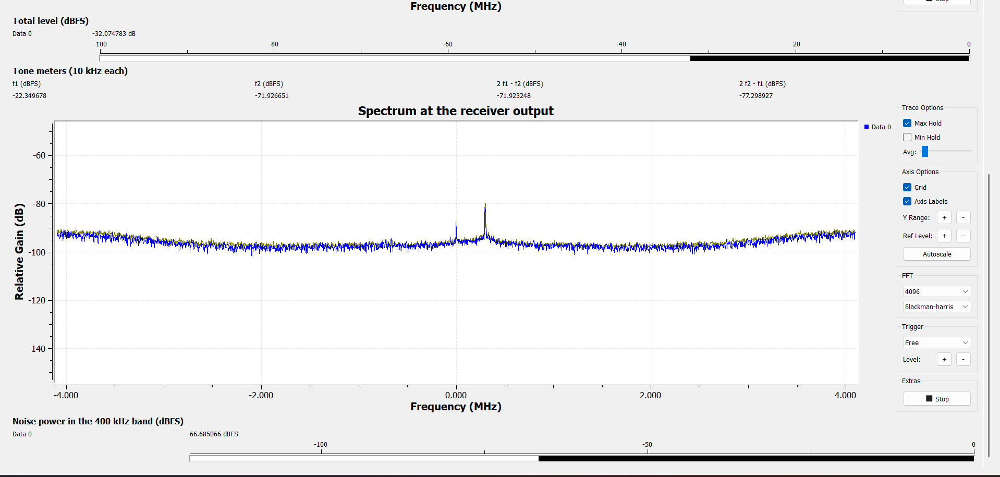

## بخش چهارم: آزمون دو‌تن و رفتار مؤلفه‌های جانبی

توان چهار نوارسنج به‌صورت عددی از هشت تصویر جاروب استخراج شد. فرکانس‌های مرجع تن‌ها `434.3` و `434.4 MHz` و محل محصولات نزدیک‌باند `434.2` و `434.5 MHz` هستند. برای هر ردیف، میانگین توان خطی دو تن و میانگین توان خطی دو مؤلفهٔ جانبی محاسبه و سپس اختلاف آن‌ها با Δ بیان شد.

| ATX (dB) | f1 (dBFS) | f2 (dBFS) | 2f1−f2 (dBFS) | 2f2−f1 (dBFS) | Δ (dB) |
| --- | --- | --- | --- | --- | --- |
| `65` | `-27.925` | `-27.931` | `-73.735` | `-73.775` | `45.827` |
| `63` | `-26.183` | `-26.188` | `-72.082` | `-72.096` | `45.903` |
| `61` | `-25.794` | `-25.799` | `-71.651` | `-71.695` | `45.877` |
| `59` | `-23.977` | `-23.982` | `-70.050` | `-70.116` | `46.103` |
| `57` | `-23.292` | `-23.297` | `-69.301` | `-69.335` | `46.024` |
| `55` | `-18.825` | `-18.830` | `-64.904` | `-64.913` | `46.081` |
| `53` | `-16.724` | `-16.729` | `-62.884` | `-62.929` | `46.180` |
| `51` | `-14.154` | `-14.159` | `-60.417` | `-60.387` | `46.245` |

سطوح ثبت‌شدهٔ دو‌تن. واحد تمام توان‌های خروجی dBFS و واحد اختلاف Δ دسی‌بل است.

بیشترین اختلاف سطح دو تن فقط `0.0053 dB` است؛ بنابراین دو تن از نظر سطح متوازن‌اند. در تصویر کف نویز، سطح دو نوار جانبی به‌ترتیب `−84.401` و `−84.406 dBFS` خوانده شد. در کم‌توان‌ترین ردیف جاروب نیز مؤلفه‌های جانبی حداقل `10.63 dB` از کف مربوط بالاترند. پس تغییر مشاهده‌شده صرفاً جابه‌جایی یک نوارسنج در کف نویز نیست.

| مؤلفه | شیب برازش برحسب افزایش ورودی (dB/dB) | تفسیر |
| --- | --- | --- |
| تن اول | `0.9839` | رشد تقریباً یک‌به‌یک |
| تن دوم | `0.9839` | رشد تقریباً یک‌به‌یک |
| مؤلفهٔ `2f1−f2` | `0.9536` | رشد نزدیک یک؛ متفاوت با شیب مکعبی |
| مؤلفهٔ `2f2−f1` | `0.9564` | رشد نزدیک یک؛ متفاوت با شیب مکعبی |
| مؤلفه‌های جانبی پس از کسر خطی کف | `0.9795, 0.9825` | نتیجهٔ نزدیک یک با اصلاح کف نیز حفظ می‌شود |

شیب‌ها با برازش کمترین مربعات روی هشت سطح به دست آمده‌اند. محور ورودی از تغییر تضعیف فرستنده ساخته شده است.

میانگین Δ در هشت سطح `46.03 dB` و انحراف معیار آن میان سطح‌ها `0.14 dB` است. تقریباً ثابت‌ماندن این فاصله و رشد نزدیک یک در مؤلفه‌های جانبی، با یک مؤلفهٔ همراه منبع یا مسیر اندازه‌گیری که همراه تن اصلی مقیاس می‌شود سازگار است. این رفتار برای انتساب محصولات به غیرخطی‌بودن مکعبی گیرنده کافی نیست. آزمون تغییر بهرهٔ مستقل، راه تفکیک سهم منبع و گیرنده در دستورکار است؛ از روند موجود منشأ قطعی تعیین نمی‌شود.

اعمال صوری رابطهٔ `Pin + Δ/2`، از کمترین تا بیشترین ورودی، اعداد `−77.59` تا `−63.38 dBm` را ایجاد می‌کند؛ یعنی شاخص با تغییر سطح حدود `14.21 dB` جابه‌جا می‌شود. یک IIP3 حاصل از مدل مکعبی باید در ناحیهٔ معتبر تقریباً ثابت بماند. بنابراین نمودار زیر از این محاسبه به‌عنوان آزمون تشخیصی استفاده می‌کند و نقطهٔ تقاطع را به‌عنوان مشخصهٔ ذاتی گیرنده گزارش نمی‌کند.

در نخستین ردیف ثبت‌شده (`ATX = 65 dB`)، مؤلفه‌های جانبی از کف قابل تفکیک‌اند. در نتیجه آستانهٔ ظهور آن‌ها، در محور اسمی، حداکثر `−100.5 dBm` به‌ازای هر تن است؛ خود آستانه در بین نقاط جاروب محصور نشده است. در قوی‌ترین ردیف، توان ورودی کل دو تن برابر مجموع خطی آن‌ها و حدود `3.01 dB` بیشتر از توان هر تن است.

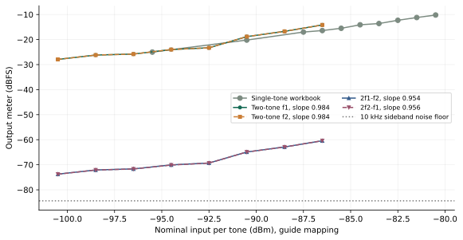

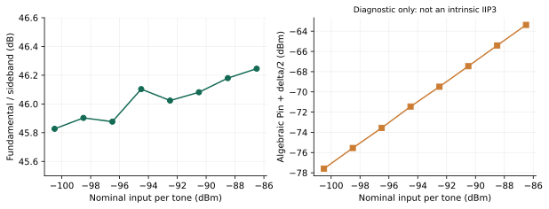

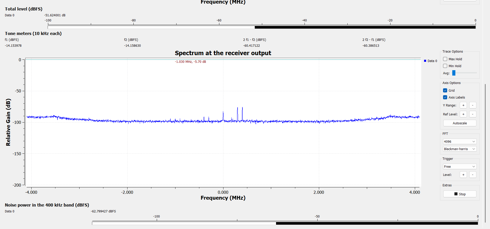

## بهرهٔ کاری، کف نویز و دامنهٔ دینامیکی

در این مجموعه، بهرهٔ `40.2 dB` نقطهٔ کار مشترک آزمون دو‌تن و تنظیم مرجع بخش سوم است. برای همین بهره، نتیجهٔ Y-Factor با ENR اسمی قابل تفسیر است و جاروب تک‌تن نیز رفتار تقریباً خطی نشان می‌دهد. از این رو، این بهره به‌عنوان نقطهٔ کار بررسی‌شده برای ادامهٔ آزمون انتخاب می‌شود. انتخاب بیشینهٔ SFDR میان سه بهره، به مشخصهٔ خطی‌بودن متناظر هر سه تنظیم نیاز دارد؛ نقطهٔ کار بررسی‌شده با ادعای بهینه‌بودن سراسری یکسان نیست.

```text
Nfloor,in = −174 + NF + 10 log10(B / 1 Hz)
```

```text
SFDR3 = (2/3) × (IIP3 − Nfloor,in)
```

با `B = 400 kHz` و NF اسمی روش Y-Factor، کف نویز ورودی مدل برابر `−98.57 dBm` می‌شود. استفاده از برآورد مستقیم، مقدار `−94.25 dBm` را می‌دهد. این دو مقدار نشان می‌دهند که اختلاف NF به همان اندازه کف نویز مدل را جابه‌جا می‌کند. برای محاسبهٔ عددی SFDR، IIP3 باید با آزمون شیب تأیید و به همان مرجع توان ورودی کالیبره شود. در دادهٔ فعلی، نتیجهٔ کمی خطی‌بودن همان کران P1dB و تضعیف نسبی `46.03 dBc` است؛ این دو کمیت جایگزین SFDR3 نمی‌شوند.

با ثابت فرض‌کردن IIP3، اختلاف `4.32 dB` بین برآوردهای NF حدود `2.88 dB` بر مقدار محاسبه‌شدهٔ SFDR اثر می‌گذارد. افزایش بهره می‌تواند سهم نویز طبقات بعدی را کم کند، اما همزمان حاشیهٔ ورودی تا محدودیت دامنهٔ مبدل را کاهش می‌دهد. این دو اثر علت بررسی همزمان NF و خطی‌بودن هنگام انتخاب بهره‌اند.

## بخش پنجم: پاسخ فرکانسی آنتن

فایل `Part5_antenna_response.csv` شامل ۱۳۱ نمونه از `400 MHz` تا `3000 MHz` با گام `20 MHz` است. کمیت ذخیره‌شده، بیشینهٔ توان دریافتی نسبی در هر فرکانس است. تنظیمات تصویر رابط، تضعیف TX برابر ۵۰ دسی‌بل و بهرهٔ دستی RX برابر ۲۰ دسی‌بل را نشان می‌دهد. همهٔ نقاط CSV در نمودار حفظ شده‌اند و برای یافتن نقاط قطع فقط بین نمونه‌های مجاور قلهٔ اصلی درون‌یابی شده است.

```text
Ppeak = −28.103956 dB relative     ;     fpeak = 1660 MHz
```

معیار بخش اندازه‌گیری دستورکار، افت سه دسی‌بل از بیشینهٔ منحنی دریافتی است. آستانهٔ متناظر `−31.103956 dB` است. تقاطع پایین در بازهٔ `1600–1620 MHz` و تقاطع بالا در بازهٔ `1700–1720 MHz` قرار دارد. نزدیک‌ترین دو تقاطع پیرامون قلهٔ اصلی انتخاب شده‌اند تا پهنای باند یک باند پیوسته محاسبه شود.

```text
fcross = fa + (Pthreshold − Pa) × (fb − fa) / (Pb − Pa)
```

| کمیت | مقدار |
| --- | --- |
| فرکانس قلهٔ نمونه‌برداری‌شده | `1660 MHz` |
| سطح بیشینه | `−28.10 dB relative` |
| آستانهٔ افت سه‌دسی‌بلی | `−31.10 dB relative` |
| فرکانس قطع پایین `fL` | `1605.6 MHz` |
| فرکانس قطع بالا `fH` | `1719.1 MHz` |
| پهنای باند `fH − fL` | `113.5 MHz` |
| پهنای باند کسری نسبت به قله | `6.83%` |

پهنای باند افت سه‌دسی‌بلی پاسخ پیوند آنتنی، مطابق معیار مستقیم نمودار دستورکار.

در آغاز بخش آنتن دستورکار، اثر عبور سیگنال از دو آنتن نیز ذکر شده است. برای دو آنتن مشابه و با فرض ثابت یا جبران‌شده‌بودن پاسخ تجهیزات و مسیر، تغییر پاسخ دسی‌بلی یک آنتن نصف تغییر پاسخ زوج است. بنابراین افت سه دسی‌بل در یک آنتن به افت شش دسی‌بل در زوج مربوط می‌شود. این معیار با افت سه دسی‌بل خود منحنی دریافت تفاوت دارد.

| معیار | fL (MHz) | fH (MHz) | BW (MHz) |
| --- | --- | --- | --- |
| افت `3 dB` در پاسخ دریافتی زوج | `1605.6` | `1719.1` | `113.5` |
| افت `6 dB` در زوج؛ معادل `3 dB` تک‌آنتن با فرض فوق | `1557.3` | `1753.0` | `195.7` |

تفکیک دو تعریف پهنای باند. نتیجهٔ تک‌آنتن به فرض دو آنتن مشابه و جبران مسیر وابسته است.

پاسخ ثبت‌شده، پاسخ نسبی کل پیوند است و مستقیماً اندازه‌گیری بهرهٔ مطلق آنتن یا S11 نیست. در حالت کلی، توان فرستنده، پاسخ گیرنده، تلفات انتشار و بازتاب‌های محیط نیز در آن سهم دارند. حتی در مدل فضای آزاد، تلفات مسیر با فرکانس تغییر می‌کند؛ در دو قطع معیار سه‌دسی‌بلی، اختلاف این سهم حدود `0.59 dB` است. بنابراین عدد `113.5 MHz` با عنوان پهنای باند پاسخ اندازه‌گیری‌شدهٔ پیوند گزارش می‌شود و عدد `195.7 MHz` نتیجهٔ شرطی تفکیک زوج است.

دقت خوانش فرکانسی را گام جاروب تعیین می‌کند. مقادیر اعشاری جدول حاصل درون‌یابی‌اند. یک مقیاس محافظه‌کارانهٔ تفکیک، نصف گام یعنی حدود `10 MHz` برای مکان هر قطع و حدود `20 MHz` برای تفاضل دو قطع است؛ این مقیاس، فاصلهٔ اطمینان آماری نیست. نزدیک قلهٔ اصلی، باند دیگری پیرامون حدود یک گیگاهرتز نیز دیده می‌شود، اما برای پهنای باند قلهٔ اصلی با آن ادغام نشده است.

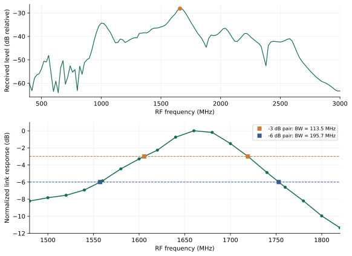

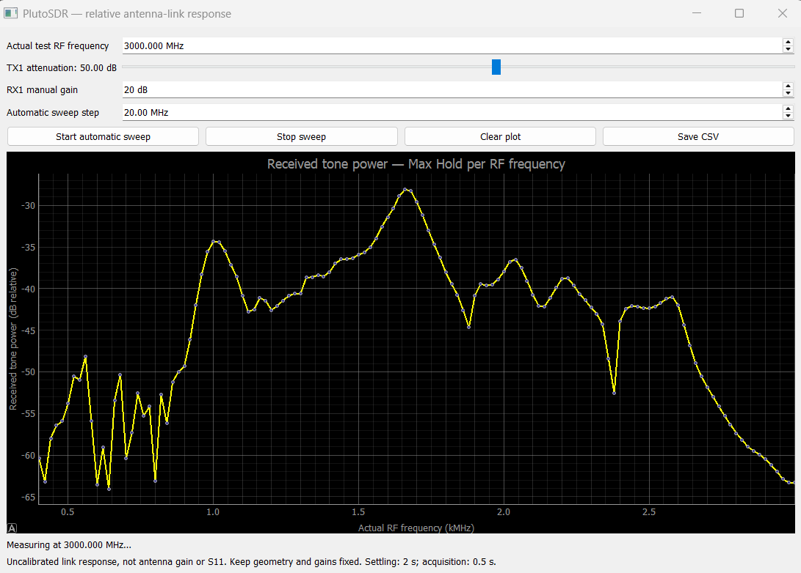

## پاسخ پرسش‌های ۱ تا ۵ دستورکار

پرسش ۱ — روش مستقیم به چه کمیت‌هایی نیاز دارد که Y-Factor به آن‌ها نیاز ندارد؟ روش مستقیم به کالیبراسیون مطلق سطح، ضریب تبدیل dBFS به ورودی و پهنای باند معادل نویز نیاز دارد. در نسبت Y، بهره و پهنای باند مشترک حذف می‌شوند؛ در عوض ENR مؤثر منبع و ثبات شرایط دو حالت لازم‌اند.

پرسش ۲ — چرا Y نباید خیلی کوچک یا خیلی بزرگ باشد؟ اگر Y خطی به یک نزدیک باشد، تفاضل Y−1 کوچک و اثر خطای خواندن بزرگ می‌شود. افزایش شدید منبع نیز ممکن است گیرنده را از ناحیهٔ خطی خارج کند. کوچک‌ترین Y جدول در بهرهٔ ۴۰٫۲ برابر `1.342972 dB` است. حساسیت موضعی NF نسبت به YdB حدود `−3.760 dB/dB` است؛ پس خطای `0.1 dB` در اختلاف قرائت‌ها حدود `0.376 dB` اثر مرتبهٔ اول دارد. محاسبهٔ دقیق برای افزایش و کاهش ۰٫۱ دسی‌بل به‌ترتیب `−0.365` و `+0.389 dB` است. این Y پایین‌تر از بازهٔ هدف `3–15 dB` دستورکار است؛ به همین علت حساسیت عددی همراه نتیجه ثبت می‌شود.

```text
∂NF / ∂YdB = −Y / (Y − 1)
```

پرسش ۳ — خروجی در نقطهٔ تراکم چند dBFS بود و عامل محدودکننده چیست؟ در سری موجود معیار افت یک‌دسی‌بلی قطع نشده است. خروجی انتهای جاروب `−10.2 dBFS` است و فقط سطح همین نقطه را مشخص می‌کند. بنابراین سطح خروجی در P1dB و انتساب محدودیت به ADC یا طبقات آنالوگ از این جاروب تعیین نمی‌شود. نتیجهٔ قابل گزارش، خطی‌بودن تقریبی در بازه و کران P1dB است.

پرسش ۴ — شیب اندازه‌گیری‌شده و اعتبار IIP3 چیست؟ شیب دو مؤلفهٔ جانبی `0.954` و `0.956 dB/dB` است؛ با کسر خطی کف نیز نزدیک یک باقی می‌ماند. این روند با فرض شیب سهٔ لازم برای استخراج IIP3 مکعبی مطابقت ندارد. کمیت تجربی این بخش، تضعیف نسبی حدود `46.03 dBc` و مشاهدهٔ مؤلفه‌ها از نخستین سطح جاروب است. برای تفکیک منشأ، باید سهم منبع و گیرنده با تغییر بهرهٔ مستقل مقایسه شود.

پرسش ۵ — مقایسهٔ IIP3−P1dB با ۹٫۶ دسی‌بل و علت تراکم زودتر در دو‌تن چیست؟ رابطهٔ حدود `9.6 dB` به مدل فشردگی مکعبی با فرض‌های مشخص مربوط است و یک هویت عمومی همهٔ گیرنده‌ها نیست. چون در این داده‌ها P1dB به‌صورت کران و IIP3 به‌صورت مشخصهٔ مکعبی تعیین نشده، تفاضل عددی آن‌ها ساخته نمی‌شود. از نظر فیزیکی، دو تن هم‌دامنه هنگام هم‌فازشدن، قلهٔ دامنه را دو برابر می‌کنند؛ توان قلهٔ متناظر `6.02 dB` بالاتر از یک تن است. توان متوسط کل نیز `3.01 dB` بالاتر از توان هر تن است. پس محدودیت قله می‌تواند در دو‌تن زودتر رخ دهد، حتی وقتی سطح متوسط هر تن پایین‌تر است.

## پیش‌بینی در برابر اندازه‌گیری و تحلیل اختلاف

در جدول زیر، مدل نظری با مشاهدهٔ همین جلسه مقایسه شده است. برای شیب‌ها، خطای نسبی از اختلاف نسبت به شیب مرجع محاسبه می‌شود. برای برآوردهای NF، مقایسهٔ نسبی روی ضریب نویز خطی انجام می‌شود؛ درصدگیری مستقیم از مقادیر دسی‌بلی به کار نرفته است.

| کمیت | پیش‌بینی یا مرجع | اندازه‌گیری | اختلاف و منشأ کمی |
| --- | --- | --- | --- |
| شیب تک‌تن | `1 dB/dB` | `0.9818 dB/dB` | خطای نسبی `1.82%`؛ افت نسبت به خط حداکثر `0.533 dB` |
| توازن دو تن | اختلاف نزدیک صفر؛ هدف کمتر از `0.5 dB` | حداکثر `0.0053 dB` | حدود `0.12%` اختلاف توان در بزرگ‌ترین عدم توازن؛ نسبت به صفر درصد تعریف نمی‌شود |
| شیب جانبی مدل مکعبی | `3 dB/dB` | میانگین حدود `0.9550 dB/dB` | فاصلهٔ نسبی `68.17%` از مدل؛ Δ تنها حدود `0.42 dB` در کل جاروب تغییر می‌کند |
| دو برآورد NF در بهرهٔ ۴۰٫۲ | مستقیم: `23.73 dB` | Y-Factor اسمی: `19.41 dB` | اختلاف `4.32 dB`؛ ضریب نویز مستقیم حدود `2.71` برابر است، یعنی `170.6%` بیشتر |
| P1dB | افت یک‌دسی‌بلی نسبت به خط مرجع | بیشینهٔ افت `0.533 dB` | نقطه در بازه قطع نشده؛ نتیجه به صورت کران است |
| نقاط نصف توان پاسخ پیوند | افت اسمی `3 dB` | دو قطع `1605.6` و `1719.1 MHz` | نسبت توان `10^(−3/10) = 0.5012`؛ اختلاف `0.24%` نسبت به نصف دقیق، ناشی از گردکردن معیار ۳ dB |

مقایسهٔ مدل و داده. اختلاف با شیب مکعبی، تفاوت سازوکار رشد مشاهده‌شده با مدل را بیان می‌کند، نه خطای محاسباتی برازش.

در مقایسهٔ دو برآورد نویز، نقش ENR و GFS یک‌به‌یک برحسب دسی‌بل است. در پاسخ فرکانسی، گام ۲۰ مگاهرتز و اختلاف حدود ۰٫۵۹ دسی‌بل در سهم تلفات فضای آزاد میان دو قطع، دو مقیاس مشخص برای تفسیر اعدادند. برای سری‌های تک‌تن و دو‌تن نیز دقت نمایش و تفاوت ثبت‌های مستقل از عدم قطعیت کالیبراسیون توان ورودی جدا نگه داشته شده است.

## جمع‌بندی

آزمایش نشان داد که بررسی همزمان سطح نویز، شیب انتقال و رشد مؤلفه‌های جانبی برای توصیف گیرنده ضروری است. در بهرهٔ مرجع ۴۰٫۲ و با منبع اسمی دستورکار، NF روش Y-Factor حدود ۱۹٫۴۱ دسی‌بل و برآورد مستقیم حدود ۲۳٫۷۳ دسی‌بل است. حساسیت به مرجع سطح، پهنای باند و ENR منشأ اصلی تفاوت تفسیر دو روش است.

جاروب تک‌تن رفتار تقریباً خطی را تا انتهای بازه نشان می‌دهد و P1dB بالاتر از آخرین سطح ورودی اسمی قرار دارد. در آزمون دو‌تن، توازن مناسب تن‌ها و فاصلهٔ جانبی حدود ۴۶ دسی‌بل مشاهده شد؛ رشد نزدیک یک، ویژگی تعیین‌کنندهٔ این ثبت‌هاست. پاسخ آنتنی نیز قله‌ای در ۱٫۶۶ گیگاهرتز و باند سه‌دسی‌بلی پیوسته‌ای با پهنای حدود ۱۱۳٫۵ مگاهرتز دارد. تفکیک نتایج اندازه‌گیری‌شده، کران‌ها و مدل‌های تبدیل، امکان استفادهٔ درست از این داده‌ها در انتخاب تنظیم گیرنده را فراهم می‌کند.

## داده‌ها، تصاویر و بازتولید محاسبات

فایل‌های زیر دادهٔ اولیه، عددهای استخراج‌شده و نتایج محاسبات را در کنار گزارش نگه می‌دارند. اسکریپت تحلیل از دادهٔ XLSX و CSV و جدول رونویسی تصاویر استفاده می‌کند؛ مسیر فایل تصویر در هر ردیف داده موجود است.

- [نسخهٔ PDF گزارش](report.pdf)
- [متن قابل ویرایش Markdown](report.md)
- [جدول اصلی جاروب تک‌تن](data/P1db.xlsx)
- [دادهٔ اصلی پاسخ آنتنی](data/Part5_antenna_response.csv)
- [خوانش‌های نویز و نام تصاویر](data/noise_readings.csv)
- [خوانش‌های دو‌تن و نام تصاویر](data/two_tone_readings.csv)
- [جدول استخراج تصاویر با دقت اصلی](data/readings.json)
- [خروجی کامل محاسبات](data/analysis_results.json)
- [جدول محاسبه‌شدهٔ تک‌تن](data/single_tone_analysis.csv)
- [جدول محاسبه‌شدهٔ دو‌تن](data/two_tone_analysis.csv)
- [دستورکار آزمایش دوم](data/lab_02_nf.pdf)
- [کد بازتولید محاسبات و نمودارها](../../../tools/lab02_analyze.py)

در پیوست تصویری نسخهٔ وب، همهٔ ۲۲ تصویر جلسه با نام اصلی در دسترس‌اند. با انتخاب هر تصویر می‌توان نسخهٔ اصلی را دید. PDF شامل تصاویر منتخب در محل تحلیل است؛ مجموعهٔ کامل تصاویر در بستهٔ همراه قرار دارد.

## مراجع

1. [دستورکار آزمایش ۲: عدد نویز و پارامترهای RF؛ Noise Figure, P1dB and IIP3. فایل lab_02_nf.pdf، ۹ صفحه. منبع روابط، تنظیمات مرجع و پرسش‌های گزارش.](data/lab_02_nf.pdf)
2. [Keysight Technologies, Noise Figure Measurement Accuracy: The Y-Factor Method, Application Note 57-2, 5952-3706. مرجع روش و اثر شرایط کالیبراسیون.](https://www.keysight.com/be/en/assets/7018-06829/application-notes/5952-3706.pdf)
3. [Analog Devices, IP3 and Intermodulation Guide. مرجع رشد مرتبه‌های مختلف و معنای نقطهٔ تقاطع برون‌یابی‌شده.](https://www.analog.com/en/resources/technical-articles/2022/07/16/11/30/ip3-and-intermodulation-guide.html)
4. [ثبت‌های جلسهٔ گروه: ۲۲ تصویر pictures.zip، فایل P1db.xlsx و فایل Part5_antenna_response.csv. تنظیم پیش‌فرض منبع نویز بر اساس توضیح گروه همراه داده‌ها.](data/readings.json)
