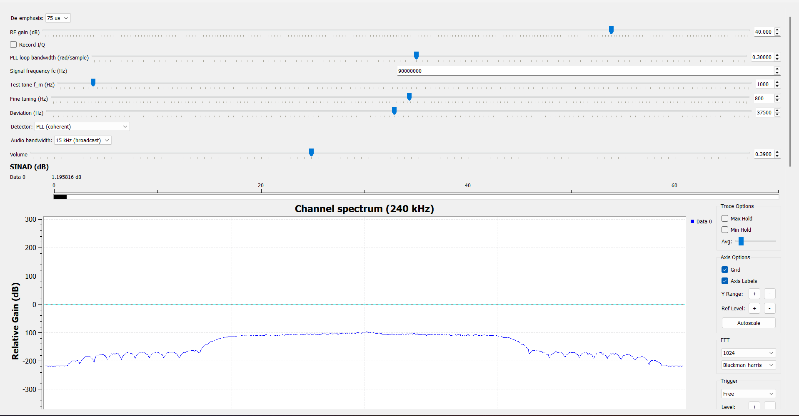
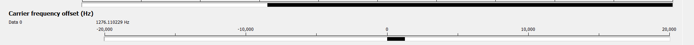
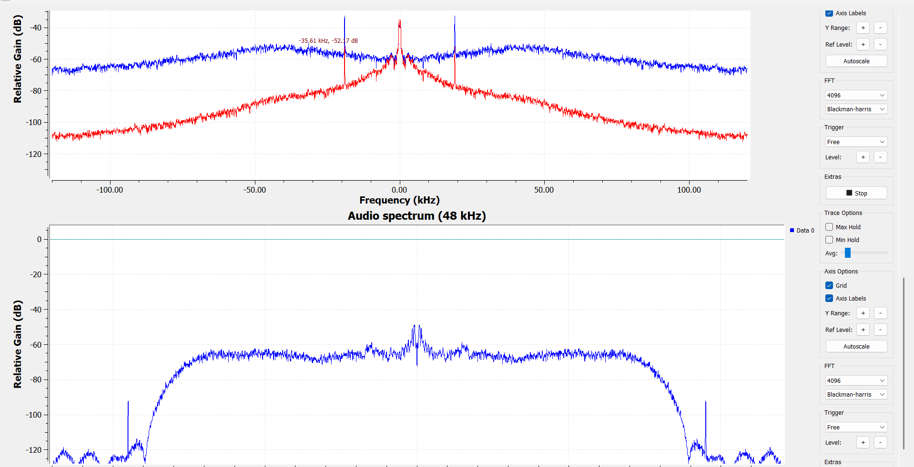
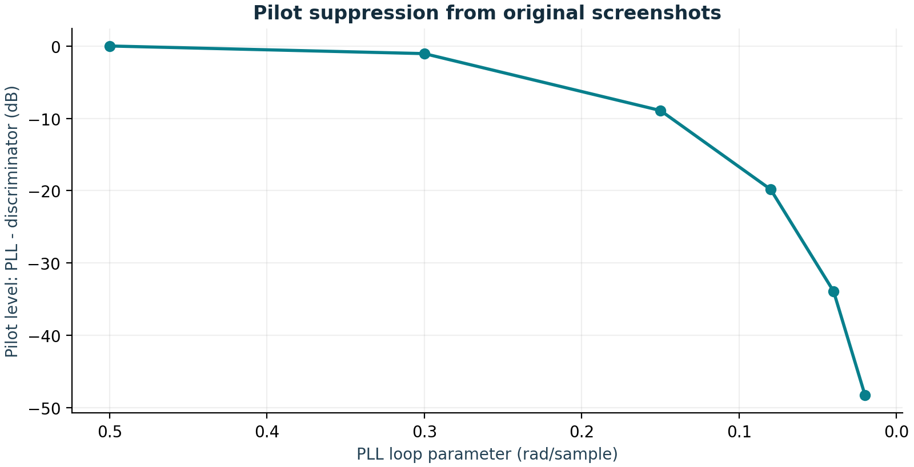
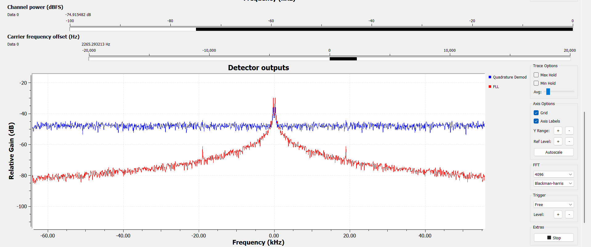
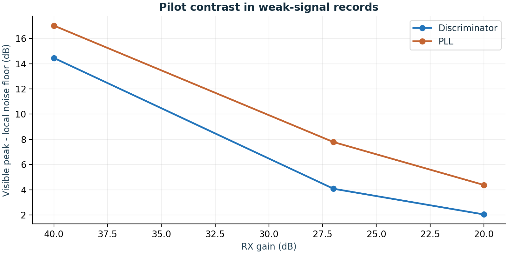
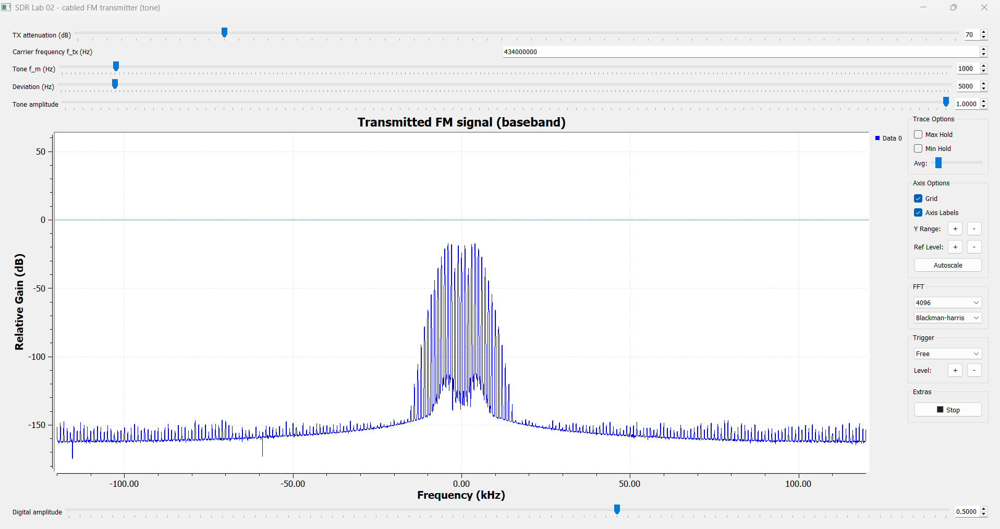
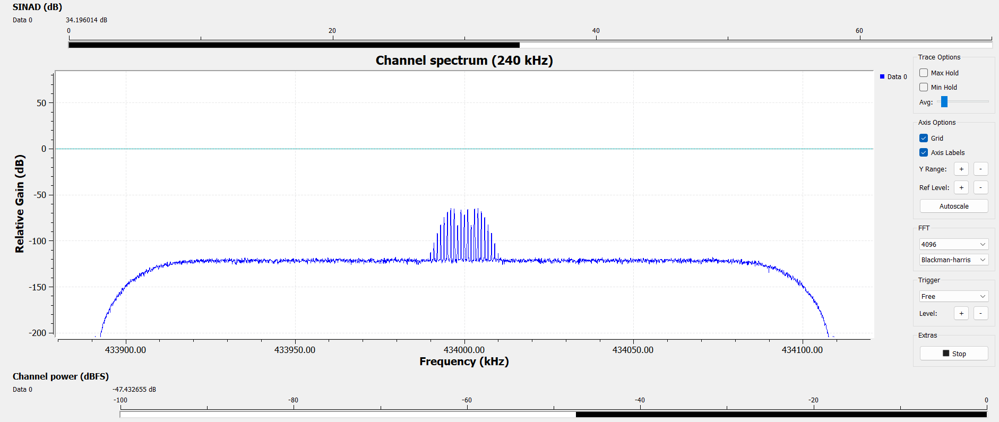
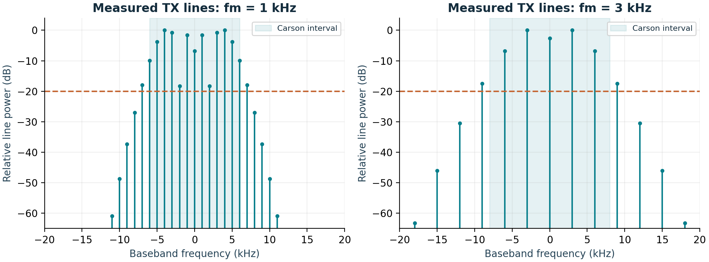

# گزارش آزمایش سوم: رادیو FM و پیوند کابلی

سروش مومنی 402102538 · مهدی قلمی نوبر 402102284

مدرس: دکتر سید محمد کرباسی


## خلاصهٔ اجرایی

در این آزمایش، دریافت رادیوی FM در فرکانس 90 MHz با دو روش تمایزگر فاز و حلقهٔ قفل فاز بررسی شد. سپس یک پیوند کابلی در 434 MHz برای مشاهدهٔ مدولاسیون تک‌تن، بازیابی صوت و مقایسهٔ پهنای باند با قاعدهٔ کارسون به کار رفت. مبنای نتایج، ۳۷ تصویر جلسه و ارزیابی شنیداری ثبت‌شدهٔ گروه است؛ روابط و ترتیب آزمون‌ها از دستورکار FM گرفته شده‌اند [۱،۲].

با کاهش پارامتر حلقه از ۰٫۵ به ۰٫۱۵، کیفیت صدا خوب باقی ماند؛ در ۰٫۰۸ متوسط شد و در ۰٫۰۲ بازیابی مفید صدا از بین رفت. افت خط پایلوت PLL نسبت به تمایزگر، از حدود صفر به حدود ۴۸ دسی‌بل رسید. در آزمون کاهش بهره نیز سه وضعیت «خوب»، «لب مرزی» و «نویز غالب» مشاهده شد. این روند، موازنهٔ اصلی میان حذف نویز و توانایی دنبال‌کردن تغییرات فرکانس را نشان می‌دهد.

نتایج شاخص جلسه

| کمیت | نتیجه | مبنای نتیجه |
| --- | --- | --- |
| فرکانس ایستگاه | 90 MHz | تنظیم رابط گیرنده |
| آفست خوانده‌شده | +1276.11 Hz؛ معادل ظاهری 14.18 ppm | نمایشگر خطای فرکانس در ایستگاه ۹۰ مگاهرتز |
| کوچک‌ترین پارامتر حلقه با صدای خوب | pll_bw = 0.15 | جدول شنیداری ۵ |
| افت پایلوت در pll_bw = 0.02 | حدود 48 dB | اختلاف دو منحنی در یک تصویر |
| پیوند کابلی | 434 MHz؛ تضعیف TX برابر 70 dB | تصویر تنظیمات فرستنده |
| CNR پیوند از زوج ثبت توان | 30.81 dB | تفریق توان در مقیاس خطی؛ با شرایط مشترک خوانش |
| SINAD ثبت پیوند | 34.20 dB | نمایشگر هم‌زمان طیف در Part3_5 |
| پهنای طیف با معیار −20 dB | 14 و 18 kHz | به‌ترتیب تن ۱ و ۳ کیلوهرتز؛ انحراف ۵ کیلوهرتز |


## هدف، چیدمان و تنظیمات

هدف بخش اول، بازیابی صوت و شناخت مؤلفه‌های باند پایهٔ پخش FM بود. بخش دوم اثر پهنای حلقه و کاهش سطح دریافت بر دو آشکارساز را بررسی کرد. بخش سوم به تولید FM تک‌تن و ارتباط شاخص مدولاسیون، خطوط جانبی و پهنای باند اختصاص داشت. شمارهٔ این فعالیت در آرشیو درس «آزمایش سوم» است؛ عنوان فایل دستورکار و نام استاندارد ضبط‌های lab02 عیناً حفظ شده‌اند.

تنظیمات و مسیر پردازش

| پارامتر | مقدار / توضیح |
| --- | --- |
| نرخ سخت‌افزار و آشکارساز | 2.4 MS/s → 240 kS/s؛ کاهش نرخ اول ۱۰، مطابق دستورکار |
| نرخ صوت | 48 kS/s؛ کاهش نرخ دوم ۵ |
| آفست انتخاب کانال | 250 kHz مطابق طراحی دستورکار؛ برای دورکردن سیگنال از DC |
| دریافت پخش | fc = 90 MHz؛ بهرهٔ مرجع 40 dB؛ پهنای صوتی 15 kHz |
| انحراف تنظیمی گیرنده | آغاز دریافت: 75 kHz؛ تصویر تنظیم مقایسهٔ PLL: 37.5 kHz |
| واتأکید | τ = 75 μs در تصاویر تنظیمات |
| پهنای فیلتر کانال در طراحی | min[2(dev + audio_bw), 200 kHz]؛ برابر 180 یا 105 kHz برای دو تنظیم بالا |
| فرستندهٔ کابلی | fTX = 434 MHz؛ dev = 5 kHz؛ fm = 1 و 3 kHz؛ aTX = 0.5؛ am = 1 |
| تضعیف فرستنده | 70 dB در تصاویر؛ محاسبات پیوند بر همین تنظیم استوار است |
| تفکیک طیفی | در نمای خطوط جانبی و مقایسهٔ آشکارسازها: FFT = 4096، پنجرهٔ Blackman–Harris؛ در بعضی نماهای کلی: 1024 |

در دریافت پخش، آنتن به ورودی گیرنده متصل می‌شود. چیدمان مرجع پیوند شامل فرستنده، مسیر کابل و تضعیف، و ورودی گیرنده است. برای برآورد توان ورودی از رابطهٔ دستورکار استفاده می‌شود؛ با تضعیف تنظیم‌شدهٔ ۷۰ دسی‌بل و دامنهٔ دیجیتال ۰٫۵، توان اسمی پیش از تلفات مسیر حدود −69.02 dBm است. با فرض مسیر مرجع دارای پد ۳۰ دسی‌بل و کابل ۰٫۵ دسی‌بل، مقدار به −99.52 dBm می‌رسد. این اعداد برآورد اسمی‌اند؛ عدد نمایشگر گیرنده با واحد dBFS مستقیماً dBm نیست [۱].

```text
P_RX,nom = 7 - A_TX + 20 log10(a_TX) - A_pad - L_cable [dBm]
```

```text
RF → frequency translation / decimation ×1/10 → channel filter → {quadrature, PLL} → audio LPF / decimation ×1/5 → DC blocker → de-emphasis → audio
```



شکل 1. نمونهٔ تنظیمات واقعی مقایسه: ایستگاه ۹۰ مگاهرتز، بهرهٔ ۴۰ دسی‌بل، dev برابر ۳۷٫۵ کیلوهرتز و انتخاب آشکارساز PLL.


## روابط و روش استخراج داده

تمایزگر با اختلاف فاز دو نمونهٔ متوالی، فرکانس لحظه‌ای را برآورد می‌کند. با نرمال‌سازی نسبت به انحراف تنظیمی، خروجی زیر به دست می‌آید [۳].

```text
y_Q[n] = fq / (2π dev) × arg{x[n] x*[n−1]}
```

اگر ورودی دارای خطای ثابت فرکانس δf باشد، در خروجی تمایزگر مقدار ثابت δf/dev ظاهر می‌شود. اندازه‌گیر خطا، میانگین همین خروجی را در dev ضرب می‌کند؛ در مسیر صوت، DC Blocker این مؤلفهٔ ثابت را حذف می‌کند. آشکارساز PLL نیز برآورد فرکانس را برحسب رادیان بر نمونه می‌دهد و برای مقایسه با تمایزگر به همان ضریب مقیاس نیاز دارد [۴].

```text
δf = dev × mean(y_Q)     ;     ppm_apparent = 10⁶ δf / fc
```

برای توان‌های روشن و خاموش یا ایستگاه و کانال مجاور، ابتدا به مقیاس خطی تبدیل می‌کنیم. اختلاف دو عدد دسی‌بلی به‌تنهایی CNR نیست؛ این اختلاف نسبت توان کل به نویز را می‌دهد.

```text
CNR_linear = (P_on − P_off) / P_off
```

```text
CNR_dB = 10 log10[10^((P_on,dBFS − P_off,dBFS)/10) − 1]
```

پهنای حلقهٔ جدول ۵ دقیقاً با قرارداد تبدیل داده‌شده در دستورکار محاسبه شده است. این کمیت معادل آموزشی پهنای حلقه است و نباید با فرکانس قطع یک فیلتر یک‌قطبی یکسان گرفته شود.

```text
B_L ≈ 1.06 × pll_bw × fq     ;     fq = 240000 sample/s
```

```text
β = Δf / fm     ;     B_Carson ≈ 2(Δf + W)     ;     A_n = A × J_n(β)
```

خوانش توان و خطای فرکانس از عدد نمایشگر انجام شده است. برای پایلوت، قلهٔ نزدیک ±۱۹ کیلوهرتز روی هر منحنی و برای نویز، میانهٔ تراز در دو بازهٔ اطراف ±۱۷ کیلوهرتز خوانده و دو سمت میانگین شده‌اند. برای اندازه‌گیری خطوط جانبی، تراز هر خط نسبت به قوی‌ترین خط همان تصویر سنجیده شده است. کد همراه با ثبت مختصات محورها، استخراج از پیکسل‌های آبی و قرمز را بازتولید می‌کند. ترازهای طیفی تقریبی، با دقت گزارش حدود ۱ تا ۲ دسی‌بل‌اند و واحدشان dB نسبیِ نمایشگر است؛ این ترازها چگالی توان کالیبره‌شده نیستند.


## بخش اول: دریافت FM با تمایزگر

ایستگاه ۹۰ مگاهرتز با انحراف تنظیمی ۷۵ کیلوهرتز و پهنای صوتی ۱۵ کیلوهرتز انتخاب شد. در طیف پیش از فیلتر صوتی، خط باریک ±۱۹ کیلوهرتز دیده می‌شود که با پایلوت استریو سازگار است. صوت مونو در بازهٔ صفر تا ۱۵ کیلوهرتز قرار می‌گیرد؛ مؤلفهٔ اختلاف دو کانال استریو، در صورت حضور، اطراف ۳۸ کیلوهرتز و RDS اطراف ۵۷ کیلوهرتز قرار دارند. در تصاویر این جلسه پایلوت ۱۹ کیلوهرتز واضح‌ترین مؤلفهٔ قابل شناسایی است؛ نسبت‌دادن هر برجستگی پهن به زیرحامل خاص به تنهایی از ظاهر نمودار انجام نشده است.

خوانش‌های بخش اول

| کمیت | مقدار | تصویر مرجع |
| --- | --- | --- |
| خطای فرکانس | +1276.110229 Hz | Part1_freq_offset.png |
| تنظیم ریز ثبت‌شده | −1350 Hz | Part1_f_finetune.png |
| توان ثبت ایستگاه | −70.692451 dBFS | Part1_channelPower.png |
| توان ثبت کانال مجاور | −72.003181 dBFS | Part1_emptyChannel_channelpower.png |
| واتأکید انتخاب‌شده | 75 μs | Part1_f_finetune.png |

```text
ppm_apparent = 1276.110229 / 90000000 × 10⁶ = +14.179 ppm
```

قدر مطلق تنظیم ریز ۱۳۵۰ هرتز، معادل ۱۵ ppm در این فرکانس است و از نظر مرتبه با قرائت اولیه هم‌خوان است. علامت تنظیم ریز به قرارداد جابه‌جایی فرکانسی پیاده‌سازی وابسته است؛ آفست و تنظیم ریز، دو قرائت مستقل رابط‌اند و از آن‌ها باقیماندهٔ نهایی ساخته نشده است. این برآورد، خطای ظاهری نسبت به مرکز اسمی ایستگاه است و کالیبراسیون مستقل نوسان‌ساز گیرنده محسوب نمی‌شود.



شکل 2. خوانش مستقیم آفست حامل: حدود +۱۲۷۶٫۱۱ هرتز.

زوج ثبت توان، اختلاف 1.31073 dB دارد. تحت شرط بهره و پهنای باند مشترک، نتیجهٔ محاسبه CNR ≈ −4.53 dB است؛ مقدار منفی به معنی توان سیگنال کمتر از توان نویزِ انتگرال‌گرفته‌شده در این زوج ثبت است، نه توان منفی. این برآورد به همین زوج و پهنای باند مشترک آن‌ها مربوط است. چون عددنمای توان، تنظیم فیلتر را در همان قاب نشان نمی‌دهد، این مقدار به‌عنوان CNR قطعی نوار ۲۰۰ کیلوهرتزی یا CNR ردیف‌های جدول ۶ تعمیم داده نمی‌شود.

```text
10^[(−70.692451 + 72.003181)/10] − 1 = 0.35230 → CNR ≈ −4.53 dB
```

در آزمون نصف‌کردن dev از ۷۵ به ۳۷٫۵ کیلوهرتز، ضریب تمایزگر دو برابر می‌شود؛ بنابراین در صورت ثابت‌ماندن بقیهٔ زنجیره، دامنهٔ صوت دو برابر و تراز آن حدود ۶٫۰۲ دسی‌بل بیشتر می‌شود. سیگنال فرستاده‌شده تغییر نمی‌کند. در این فلوگراف، dev هم‌زمان پهنای فیلتر کانال را از ۱۸۰ به ۱۰۵ کیلوهرتز تغییر می‌دهد؛ ازاین‌رو شکل طیف بعد از فیلتر می‌تواند باریک‌تر شود. نتیجهٔ «طیف RF تغییر نمی‌کند» دربارهٔ سیگنال ورودی پیش از فیلتر وابسته به dev است، و افزایش ۶٫۰۲ دسی‌بل، پیش‌بینی اثر ضریب مقیاس به‌تنهایی است.



شکل 3. خروجی آشکارسازها و صوت در تنظیم dev برابر ۳۷٫۵ کیلوهرتز؛ پایلوت در نمای پیش از فیلتر صوتی دیده می‌شود.

برای واتأکید، تابع مرجع H(f)=1/(1+j2πfτ) است. در فرکانس ۱۵ کیلوهرتز، تضعیف نظری برای ۵۰ و ۷۵ میکروثانیه به‌ترتیب حدود ۱۳٫۶۶ و ۱۷٫۰۷ دسی‌بل است؛ در نتیجه انتخاب ۷۵ میکروثانیه، فرکانس‌های بالای صوت را حدود ۳٫۴ دسی‌بل بیشتر کاهش می‌دهد. تصویر رابط، انتخاب ۷۵ میکروثانیه را ثبت کرده است؛ این مقایسهٔ عددی از پاسخ نظری فیلتر به دست می‌آید.


## بخش دوم: پهنای حلقه و کیفیت شنیداری

پارامتر حلقه در شش گام تغییر داده شد. کیفیت شنیداری این جدول همان ارزیابی جلسه است. اختلاف پایلوت، تراز PLL منهای تراز تمایزگر در همان تصویر است؛ علامت منفی یعنی پایلوت در خروجی PLL تضعیف شده است. در ۰٫۵، دو قله تقریباً هم‌پوشان‌اند و اختلاف حدود صفر گزارش می‌شود.

جدول ۵ دستورکار — اثر پهنای حلقه؛ ایستگاه ۹۰ مگاهرتز

| pll_bw | BL (kHz) | کیفیت صدا | Δ پایلوت (dB) | بالاتر از 23 kHz در PLL |
| --- | --- | --- | --- | --- |
| 0.5 | 127.20 | خوب | 0 | مؤلفه‌های پهن‌باند قابل مشاهده‌اند |
| 0.3 | 76.32 | خوب | -1 | مؤلفه‌های پهن‌باند قابل مشاهده‌اند |
| 0.15 | 38.16 | خوب | -9 | بسیار ضعیف‌تر |
| 0.08 | 20.35 | متوسط | -20 | مؤلفهٔ مجزا در PLL برجسته نیست |
| 0.04 | 10.18 | متوسط رو به پایین | -34 | مؤلفهٔ مجزا در PLL برجسته نیست |
| 0.02 | 5.09 | بسیار ضعیف؛ بازیابی مفید صدا از بین رفت | -48 | مؤلفهٔ مجزا در PLL برجسته نیست |

آخرین مقدار دارای صدای خوب، ۰٫۱۵ با پهنای حلقهٔ قراردادی ۳۸٫۱۶ کیلوهرتز بود. در ۰٫۰۸، افت پایلوت به حدود ۲۰ دسی‌بل رسید و کیفیت متوسط شد. ادامهٔ باریک‌کردن حلقه در ۰٫۰۴ و ۰٫۰۲، کاهش بیشتر مؤلفه‌های سریع را به همراه داشت؛ هم‌زمان صوت نیز به‌ترتیب متوسط رو به پایین و بسیار ضعیف شد. پس پایین‌آمدن کف خروجی PLL به‌تنهایی نشانهٔ بهترشدن بازیابی پیام نیست؛ باید حفظ خود پیام نیز بررسی شود.



شکل 4. تضعیف پایلوت استخراج‌شده از تصاویر اصلی؛ محور افقی در جهت کاهش پهنای حلقه مرتب شده است.

در تصویر تنظیم مقایسه با dev برابر ۳۷٫۵ کیلوهرتز، پهنای فیلتر کانال مطابق رابطهٔ دستورکار ۱۰۵ کیلوهرتز است. نسبت BL/Bchannel برای ۰٫۱۵ حدود ۰٫۳۶ و برای ۰٫۰۸ حدود ۰٫۱۹ خواهد بود. این نسبت توضیح می‌دهد چرا حلقهٔ باریک‌تر نویز خارج از ناحیهٔ تعقیب را کمتر عبور می‌دهد؛ اما مقدار بهینه به انحراف واقعی سیگنال و نیاز به تعقیب مدولاسیون نیز وابسته است.


## بخش دوم: کاهش بهره و مقایسهٔ دو آشکارساز

سه تصویر با بهره‌های ۴۰، ۲۷ و ۲۰ دسی‌بل بررسی شدند. ترتیب ارزیابی شنیداری از ثبت قوی به ضعیف، به‌ترتیب «خوب»، «لب مرزی» و «نویز غالب» است. این ارزیابی مربوط به وضعیت شنیده‌شده در هر سطح است؛ برای نتیجه‌گیری دربارهٔ تفاوت دو آشکارساز، از مقایسهٔ طیف‌های هم‌زمان استفاده می‌شود.

جدول ۶ دستورکار — مقایسه در سه سطح سیگنال؛ ترازهای طیفی تقریبی‌اند

| بهره (dB) | توان (dBFS) | پایلوت Q (dB) | نویز Q در 17 kHz | پایلوت PLL (dB) | نویز PLL در 17 kHz | شنیداری |
| --- | --- | --- | --- | --- | --- | --- |
| 40 | -64.00 | -40 | -54 | -57 | -74 | خوب |
| 27 | -74.92 | -44 | -48 | -61 | -69 | لب مرزی |
| 20 | -77.27 | -44 | -46 | -65 | -69 | نویز غالب؛ صدا قابل تشخیص نبود |

کنتراست پایلوت نسبت به کف محلی؛ از تفاضل دو ستون هم‌واحد جدول ۶

| بهره (dB) | Q: پایلوت − نویز (dB) | PLL: پایلوت − نویز (dB) | تفسیر |
| --- | --- | --- | --- |
| 40 | 14.5 | 17.0 | پایلوت در هر دو مسیر مشخص است |
| 27 | 4.1 | 7.8 | پایلوت PLL نسبت به کف محلی مشخص‌تر است |
| 20 | 2.0 | 4.4 | در تمایزگر نزدیک کف؛ در PLL نیز کم‌کنتراست |

در سطح ۲۷ دسی‌بل، کنتراست پایلوت حدود ۴٫۱ دسی‌بل برای تمایزگر و ۷٫۸ دسی‌بل برای PLL به دست آمد؛ برتری تقریبی PLL در این شاخص حدود ۳٫۷ دسی‌بل است. در سطح ۲۰ دسی‌بل، قلهٔ تمایزگر تقریباً در کف نویز قرار می‌گیرد و خوانش آن صرفاً کنتراست ظاهری حدود ۲ دسی‌بل دارد. نتیجهٔ شنیداری این سطح، نویز غالب بود. بدین ترتیب، کاهش نویز طیفی PLL در دریافت ضعیف دیده می‌شود، ولی در سطح بسیار ضعیف برای بازیابی مفید صدا کافی نیست.

عددهای پایلوت منهای کف، شاخص مقایسهٔ همان FFT هستند؛ SNR انتگرالی صوت یا نسبت توان کل پایلوت به نویز با پهنای باند مشخص نیستند. تفاضل هم‌زمان دو منحنی و یکسان‌بودن پنجرهٔ FFT، آن‌ها را برای مقایسهٔ نسبی مناسب می‌کند. چون با کاهش بهره، سهم نویز طبقات بعدی و ADC نسبت به سیگنال ورودی بیشتر می‌شود، کاهش بهره الزاماً مانند یک تضعیف‌گر ایده‌آلِ پیش از گیرنده رفتار نمی‌کند.



شکل 5. ثبت لب مرزی در بهرهٔ ۲۷ دسی‌بل: خط پایلوت در PLL با وجود تراز مطلق کمتر، نسبت به کف محلی بهتر از تمایزگر دیده می‌شود.



شکل 6. روند کنتراست پایلوت در سه بهره. در پایین‌ترین سطح، قلهٔ آبی نزدیک کف است و عدد آن باید به‌صورت خوانش ظاهری تفسیر شود.


## بخش سوم: پیوند کابلی و بازیابی تک‌تن

در فرستنده، فرکانس ۴۳۴ مگاهرتز، تضعیف ۷۰ دسی‌بل، انحراف ۵ کیلوهرتز و دامنهٔ دیجیتال ۰٫۵ در تصاویر دیده می‌شود. برای تن ۱ کیلوهرتز، شاخص مدولاسیون ۵ است و خطوط RF با فاصلهٔ ۱ کیلوهرتز ظاهر می‌شوند. با تغییر تن به ۳ کیلوهرتز و ثابت‌ماندن انحراف، شاخص به ۱٫۶۶۷ می‌رسد و فاصلهٔ خطوط سه برابر می‌شود. در طیف صوت بازیابی‌شده نیز جفت قلهٔ متناظر در دو سوی صفر دیده می‌شود.



شکل 7. تنظیمات و طیف فرستنده: تن ۱ کیلوهرتز، انحراف ۵ کیلوهرتز، تضعیف ۷۰ دسی‌بل و دامنهٔ ۰٫۵.

در ثبت تنظیم گیرندهٔ پیوند، dev برابر ۷۵ کیلوهرتز و پهنای صوتی ۱۵ کیلوهرتز دیده می‌شود؛ این dev گیرنده با انحراف واقعی ۵ کیلوهرتزی فرستنده دو کمیت جدا هستند. اولی مقیاس آشکارساز و فیلتر گیرنده را تعیین می‌کند و دومی شاخص مدولاسیون و طیف ارسالی را. تنظیم ریز در این تصویر ۲ هرتز است و SINAD آن ۳۴٫۲۸ دسی‌بل خوانده می‌شود. ثبت هم‌زمان بعدی در Part3_5، مقدار SINAD برابر ۳۴٫۲۰ دسی‌بل را نشان می‌دهد.

توان و کیفیت پیوند در ثبت‌های بخش سوم

| کمیت | مقدار | مرجع |
| --- | --- | --- |
| توان پیش از روشن‌شدن سیگنال | −78.250565 dBFS | Part3_3_rxPower.png |
| توان با سیگنال | −47.432655 dBFS | Part3_5.png |
| اختلاف تراز کل / نویز | 30.817910 dB | محاسبه از دو عدد بالا |
| CNR با تفریق خطی | 30.814311 dB | با فرض تنظیم مشترک دو قرائت |
| SINAD هم‌زمان با طیف | 34.196014 dB | Part3_5.png |

```text
CNR = 10 log10[10^(30.817910/10) − 1] = 30.8143 dB
```

این CNR مربوط به نوار مشترک اندازه‌گیری در این ثبت‌هاست؛ عدد به نوار ۱۶ کیلوهرتزی مرجع NBFM تبدیل نشده است. تضعیف واقعی فرستنده در تصاویر ۷۰ دسی‌بل است، بنابراین مقدار نیز به همین تنظیم مربوط است. SINAD نسبت توان کل صوت به توان باقی‌مانده پس از حذف تن است؛ به علت بهرهٔ پردازشی FM و تفاوت پهنای باند، برابرنبودن آن با CNR ورودی طبیعی است.



شکل 8. طیف کانال همراه با توان −۴۷٫۴۳۲۶۵۵ dBFS و SINAD حدود ۳۴٫۲۰ dB در ثبت پیوند.


## بخش سوم: پهنای باند و صفرشدن حامل

معیار خواسته‌شده در جدول ۷، فاصلهٔ بیرونی‌ترین خطوطی است که حداکثر ۲۰ دسی‌بل از قوی‌ترین خط پایین‌ترند. این پهنا با B99 یکسان تعریف نمی‌شود: اولی آستانهٔ ارتفاع خط است، درحالی‌که دومی ۹۹ درصد توان تجمعی را در بر می‌گیرد. برای استخراج از تصویر، تراز قوی‌ترین خط در هر قاب صفر شده و خطوط داخل آستانه شناسایی شده‌اند.

جدول ۷ — پهنای طیف و مقایسه با کارسون؛ Δf = 5 kHz

| fm (kHz) | β | کارسون (kHz) | طیف −20 dB (kHz) | اختلاف با کارسون | B99 نظری بسل (kHz) |
| --- | --- | --- | --- | --- | --- |
| 1.0 | 5.000 | 12.0 | 14.0 | 16.7٪ | 12.0 |
| 3.0 | 1.667 | 16.0 | 18.0 | 12.5٪ | 18.0 |

برای تن ۱ کیلوهرتز، خطوط مرتبهٔ ±۷ هنوز در آستانهٔ ۲۰ دسی‌بل قرار می‌گیرند، بنابراین پهنای خوانده‌شده حدود ۱۴ کیلوهرتز است. برای تن ۳ کیلوهرتز، خطوط مرتبهٔ ±۳ در آستانه قرار دارند و پهنا حدود ۱۸ کیلوهرتز می‌شود. کارسون در این دو مقایسهٔ آستانه‌ای به‌ترتیب ۲ کیلوهرتز، یا ۱۶٫۷ و ۱۲٫۵ درصد، کمتر برآورد می‌کند. از نظر درصد، اختلاف حالت ۱ کیلوهرتز بیشتر است؛ این اختلاف با توجه به متفاوت‌بودن معیارها تفسیر می‌شود.



شکل 9. نمودار ساخته‌شده از خوانش پیکسل‌های طیف واقعی فرستنده. خط‌چین آستانهٔ −۲۰ دسی‌بل و ناحیهٔ رنگی پهنای کارسون است؛ منحنی شبیه‌سازی جایگزین داده نشده است.

برای مقایسهٔ مستقل نظری، توان خطوط FM تک‌تن با Jₙ²(β) محاسبه شد. شرط زیر، کوچک‌ترین N لازم برای پوشاندن ۹۹ درصد توان را می‌دهد. برای β برابر ۵، N برابر ۶ و B99 نظری برابر ۱۲ کیلوهرتز است؛ برای β برابر ۵/۳، N برابر ۳ و B99 نظری برابر ۱۸ کیلوهرتز به دست می‌آید. در نتیجه در حالت دوم، کارسون از B99 نظری نیز ۱۲٫۵ درصد کمتر است. B99 اندازه‌گیری‌شده از IQ در بخش تحلیل تکمیلی ثبت می‌شود.

```text
J₀²(β) + 2 Σ[n=1..N] Jₙ²(β) ≥ 0.99     ;     B99,theory = 2 N fm
```

در روش کالیبراسیون صفر حامل، دامنهٔ مؤلفهٔ مرکزی متناسب با J₀(β) است؛ دو ریشهٔ اول آن ۲٫۴۰۴۸۲۶ و ۵٫۵۲۰۰۷۸ هستند. با ثابت‌بودن تن در ۱ کیلوهرتز، انحراف‌های مرجع زیر حاصل می‌شوند. صفرشدن حامل به معنی حذف همهٔ توان FM نیست؛ توان به خطوط جانبی منتقل می‌شود.

مرجع نظری کالیبراسیون انحراف؛ fm = 1 kHz

| صفر J0 | β نظری | انحراف نظری (Hz) | مقدار گرد‌شدهٔ مرجع (Hz) |
| --- | --- | --- | --- |
| اول | 2.4048256 | 2404.8256 | 2405 |
| دوم | 5.5200781 | 5520.0781 | 5520 |

تصاویر با برچسب‌های ۲۴۰۵ و ۵۵۲۰ در مجموعهٔ جلسه، طیف صوت و خروجی آشکارساز را نمایش می‌دهند؛ در آن‌ها جفت قلهٔ صوتی نزدیک همین فرکانس‌ها دیده می‌شود. ملاک تعیین صفر J0، مؤلفهٔ مرکزی طیف RF پیش از آشکارساز در حالی است که fm ثابت مانده و dev جاروب می‌شود. بنابراین مقدارهای بالا به‌عنوان مرجع نظری کالیبراسیون ثبت شده‌اند و با جابه‌جایی قلهٔ صوت یکی گرفته نمی‌شوند.

تفکیک خانه‌های FFT در نرخ ۲۴۰ کیلوهرتز و طول ۴۰۹۶، حدود ۵۸٫۵۹ هرتز است. خطای گردکردن تنظیم انحراف به مقادیر صحیح ۲۴۰۵ و ۵۵۲۰، به‌ترتیب +۰٫۱۷۴۴ و −۰٫۰۷۸۱ هرتز خواهد بود؛ این‌ها خطای گردکردن مرجعند. برای برآورد اثر تشخیص «صفر»، اگر حد آشکارسازی دامنهٔ حامل ۱٪ دامنهٔ کل باشد، با تقریب J₀(β)≈−J₁(β₀)δβ، بازهٔ انحراف تقریباً ±۱۹٫۳ هرتز در صفر اول و ±۲۹٫۴ هرتز در صفر دوم است. این دو عدد سناریوی حساسیت با آستانهٔ اعلام‌شده‌اند، نه عدم قطعیت تجربی ادعاشده.


## پاسخ پرسش‌های ۱ تا ۶ دستورکار

### پرسش ۱ — نصف‌کردن dev چه اثری دارد؟

ضریب آشکارساز معکوس dev است؛ نصف‌کردن آن دامنهٔ خروجی را دو برابر و تراز را ۶٫۰۲ دسی‌بل بیشتر می‌کند. RF فرستاده‌شده ثابت است. در پیاده‌سازی حاضر فیلتر کانال هم به dev وابسته است؛ به همین دلیل باید طیف ورودی پیش از فیلتر را از طیف خروجی فیلتر جدا کرد.

### پرسش ۲ — چرا خطای فرکانس به شکل مقدار ثابت ظاهر می‌شود؟

آفست ثابت به فاز، جملهٔ خطی ۲πδft اضافه می‌کند و مشتق فاز آن ثابت است. مقدار خوانده‌شدهٔ این جلسه، معادل ظاهری +۱۴٫۱۸ ppm در ۹۰ مگاهرتز است. گزارش آزمایش اول سایت، برآورد مشروط FCCH حدود −۲٫۱۸ ppm را آورده است [۵]؛ این دو عدد در علامت و اندازه یکسان نیستند. چون روش مرجع، باند فرکانسی و شرایط دو آزمون متفاوت است، نتیجهٔ FM را به‌صورت آفست ظاهری همان ایستگاه گزارش می‌کنیم و آن را تأیید عددی کالیبراسیون قبلی نمی‌دانیم.

### پرسش ۳ — چرا PLL باریک مؤلفه‌های ۳۸ و ۵۷ کیلوهرتز را تضعیف می‌کند؟

حلقه فقط تغییرات فاز و فرکانسی را که در محدودهٔ تعقیب زمانی آن قرار می‌گیرند دنبال می‌کند. مؤلفه‌های بالاتر سریع‌ترند و با باریک‌شدن حلقه زودتر تضعیف می‌شوند. باریک‌کردن بیشتر در نهایت خود صوت را نیز دچار اعوجاج می‌کند؛ افت کیفیت از ۰٫۰۸ به پایین با این سازوکار سازگار است.

### پرسش ۴ — پایلوت به نویز در سیگنال ضعیف برای کدام بهتر بود؟

در ثبت بهرهٔ ۲۷ دسی‌بل، شاخص پایلوت منهای کف محلی برای PLL حدود ۷٫۸ و برای تمایزگر ۴٫۱ دسی‌بل بود. PLL در این شاخص حدود ۳٫۷ دسی‌بل برتری داشت. کاهش نسبت پهنای حلقه به پهنای کانال سهم نویز خروجی را کم می‌کند؛ حلقه باید هم‌زمان به اندازهٔ کافی برای دنبال‌کردن پیام پهن بماند.

### پرسش ۵ — اختلاف با صفرهای نظری از کجا می‌آید؟

مرجع نظری برای fm برابر ۱ کیلوهرتز، ۲۴۰۴٫۸۳ و ۵۵۲۰٫۰۸ هرتز است. سهم تنظیم برابر نصف گام مؤثر کنترل dev است؛ مثلاً گام ۵۰ هرتز، سهم کوانتیزهٔ ±۲۵ هرتز دارد. تفکیک FFT برابر ۵۸٫۵۹ هرتز، مقیاس تعیین مکان خط را مشخص می‌کند، اما مستقیماً به همین مقدار خطای dev تبدیل نمی‌شود. تشخیص صفر از کف طیف، با فرض آستانهٔ دامنهٔ ۱٪، حساسیت‌های تقریبی ±۱۹٫۳ و ±۲۹٫۴ هرتز دارد. برای عدم قطعیت نهایی باید گام واقعی جاروب و آستانهٔ تشخیص همان ثبت استفاده شود.

### پرسش ۶ — کارسون در کدام حالت کمتر برآورد می‌کند؟

در مقایسه با معیار −۲۰ دسی‌بل، هر دو حالت: ۱۲ در برابر ۱۴ کیلوهرتز برای تن ۱ کیلوهرتز و ۱۶ در برابر ۱۸ کیلوهرتز برای تن ۳ کیلوهرتز. در مقایسهٔ ۹۹ درصد توان نظری بسل، حالت ۳ کیلوهرتز مقدار ۱۸ کیلوهرتز دارد و کارسون ۱۲٫۵ درصد کمتر است؛ در حالت ۱ کیلوهرتز B99 نظری ۱۲ کیلوهرتز و برابر کارسون است.


## پیش‌بینی در برابر مشاهده و تحلیل دقت

مقایسهٔ مدل و داده؛ نوع مرجع هر سطر مشخص است

| کمیت | پیش‌بینی / مرجع | مشاهده یا محاسبه | اختلاف و عامل کمی |
| --- | --- | --- | --- |
| مقیاس تمایزگر با نصف‌شدن dev | دامنه ×۲؛ +6.02 dB | تنظیم 37.5 kHz در تصویر | پیش‌بینی ضریب مقیاس؛ با تغییر هم‌زمان پهنای فیلتر |
| ردیابی در حلقهٔ پهن | صوت سالم در 0.3 و بالاتر | خوب تا 0.15 | گذار شنیداری میان 0.15 و 0.08 محصور است؛ نقطهٔ دقیق درون‌یابی نشده |
| پهنای تن 1 kHz | کارسون 12 kHz | معیار −20 dB: 14 kHz | +2 kHz؛ +16.7٪ نسبت به کارسون؛ تفاوت تعریف پهنا |
| پهنای تن 3 kHz | کارسون 16 kHz | معیار −20 dB: 18 kHz | +2 kHz؛ +12.5٪؛ خطوط مرتبهٔ سوم هنوز در آستانه‌اند |
| صفرهای حامل | 2404.826 و 5520.078 Hz | مرجع گرد‌شده: 2405 و 5520 Hz | خطای گردکردن 0.0073٪ و −0.0014٪؛ نتیجهٔ تجربی صفر با این درصدها تعریف نشده |
| خطای نسبت به مرکز ایستگاه | پس از تنظیم: هدف نزدیک صفر | قرائت اولیه +1276.11 Hz؛ تنظیم ثبت‌شده −1350 Hz | معادل‌های قدرمطلق: 14.18 و 15 ppm؛ دو ثبت مستقل |
| شاخص پایلوت در بهرهٔ 27 | حذف نویز توسط PLL باریک | 7.8 در برابر 4.1 dB | اختلاف حدود 3.7 dB؛ خوانش طیفی حدود 1–2 dB |

در خوانش B20، جای خطوط از فاصلهٔ تن معلوم است و تصمیم حساس، قرارگرفتن خط مرزی در آستانه است. تغییر انتخاب یک مرتبه در هر سمت، پهنا را برای تن ۱ کیلوهرتز ۲ کیلوهرتز و برای تن ۳ کیلوهرتز ۶ کیلوهرتز تغییر می‌دهد. در تصاویر حاضر، خط مرتبهٔ ۷ در حالت اول حدود −۱۸ دسی‌بل و خط مرتبهٔ ۸ حدود −۲۷ دسی‌بل است؛ در حالت دوم، مراتب ۳ و ۴ حدود −۱۷ و −۳۰ دسی‌بل‌اند. بنابراین انتخاب مرز با فاصلهٔ قابل مشاهده از آستانه انجام شده است. خطای مکان‌یابی پیکسلی چند ده تا چند صد هرتز، از جابه‌جایی یک مرتبه کوچک‌تر است.

برای زوج توان بخش اول، CNR به خطای تفاضل ترازها حساس است: در اختلاف ۱٫۳۱ دسی‌بل، حساسیت مرتبهٔ اول حدود ۳٫۸۴ دسی‌بل تغییر CNR به ازای یک دسی‌بل تغییر تفاضل است. اگر خطای هر قرائت مستقل و ۰٫۱ دسی‌بل در نظر گرفته شود، سهم تقریبی عدم قطعیت CNR حدود ۰٫۵۴ دسی‌بل می‌شود. در پیوند با اختلاف حدود ۳۰٫۸۲ دسی‌بل، حساسیت تقریباً یک است و همان فرض، سهمی حدود ۰٫۱۴ دسی‌بل می‌دهد. این سناریو دقت خوانش را نشان می‌دهد؛ همسانی بهره و پهنای باند شرط جداگانهٔ اعتبار نسبت توان است.


## تحلیل تکمیلی فایل‌های I/Q و فایل‌های همراه

فایل‌های I/Q گروه در پوشهٔ iq/ قرار می‌گیرند. جای نتیجه‌های تکمیلی در جدول زیر پیش‌بینی شده است؛ پس از افزودن فایل‌ها و اجرای کد، اندازه‌گیری B99، نمودار PSD و پخش صوت در همین بخش قرار می‌گیرد. نام اصلی ضبط‌ها حفظ می‌شود و مشخصات واقعی هر ضبط در data/iq_manifest.json ثبت خواهد شد.

نتایج تکمیلی ضبط‌های گروه

| ضبط | B99 اندازه‌گیری‌شده | نمودار / صوت |
| --- | --- | --- |
| ایستگاه ۹۰ مگاهرتز | محل درج نتیجهٔ IQ | — |
| سطح بهرهٔ ۴۰ | محل درج نتیجهٔ IQ | — |
| سطح بهرهٔ ۲۷ | محل درج نتیجهٔ IQ | — |
| سطح بهرهٔ ۲۰ | محل درج نتیجهٔ IQ | — |
| تن ۱ کیلوهرتز؛ dev=5 kHz | محل درج نتیجهٔ IQ | — |
| تن ۳ کیلوهرتز؛ dev=5 kHz | محل درج نتیجهٔ IQ | — |

روش B99: محاسبهٔ Welch روی نمونه‌های مختلط، انتخاب بازهٔ تک‌کاناله، انتگرال‌گیری در مقیاس خطی، و تعیین دو مرز ۰٫۵ و ۹۹٫۵ درصد توان تجمعی. اگر ضبط نویز با همان تنظیمات معرفی شود، PSD نویز پیش از انتگرال‌گیری تفریق می‌شود. محدودهٔ تحلیل و استفاده یا عدم استفاده از تفریق نویز در خروجی JSON ذخیره می‌شود. صوت قابل پخش از تمایزگر، فیلتر صوتی، تبدیل نرخ و واتأکید ساخته می‌شود؛ دامنهٔ WAV برای پخش نرمال می‌شود.

- [نسخهٔ PDF گزارش](report.pdf)
- [متن قابل ویرایش Markdown](report.md)
- [اعداد نمایشگرها با نام تصویر مرجع](data/number_sink_readings.csv)
- [داده و محاسبات جدول ۵](data/table05_pll.csv)
- [داده و محاسبات جدول ۶](data/table06_weak_signal.csv)
- [پهنای باند و مدل بسل](data/table07_bandwidth.csv)
- [خروجی کامل محاسبات](data/results.json)
- [کد استخراج تصاویر و رسم نمودارها](code/analyze_screenshots.py)
- [کد تحلیل I/Q و تولید صوت](code/analyze_iq.py)
- [مسیر بلوک‌ها و نسخه‌های بازسازی‌شدهٔ آفلاین](flowgraphs/README.md)
- [دستورکار FM](assets/lab_02_fm.pdf)


## جمع‌بندی و پیشنهاد برای تکرار آزمایش

دریافت FM با دو آشکارساز نشان داد که حلقهٔ پهن، مؤلفه‌های بیشتری از باند پایه را دنبال می‌کند، درحالی‌که حلقهٔ باریک‌تر کف نویز کمتری دارد. محدودهٔ عملی مناسب در آزمون شنیداری این جلسه تا پارامتر ۰٫۱۵ ادامه داشت. در کاهش بهره، PLL کنتراست پایلوت بهتری نشان داد؛ بااین‌حال در پایین‌ترین سطح، نویز بر صوت غالب شد. پیوند کابلی نیز فاصلهٔ خطوط جانبی و اثر نسبت انحراف به فرکانس پیام را به‌روشنی نشان داد. پهنای آستانه‌ای ۱۴ و ۱۸ کیلوهرتز در کنار برآوردهای ۱۲ و ۱۶ کیلوهرتزی کارسون، ضرورت مشخص‌کردن تعریف پهنای باند را برجسته می‌کند.

اگر آزمایش را دوباره انجام می‌دادیم، در هر تغییر تنظیم یک قاب شامل پارامترها، توان و طیف می‌گرفتیم تا قرائت‌ها دقیقاً هم‌زمان باشند. حوالی گذار شنیداری بین ۰٫۱۵ و ۰٫۰۸، گام حلقه را کوچک‌تر انتخاب می‌کردیم. برای کالیبراسیون صفر حامل، fm را در ۱ کیلوهرتز ثابت نگه می‌داشتیم و dev را با گام معلوم در اطراف هر ریشه جاروب می‌کردیم؛ حداقل خط مرکزی در طیف RF و یک ضبط I/Q کوتاه، نتیجهٔ کالیبراسیون و عدم قطعیت آن را مستقیم قابل محاسبه می‌کرد. برای نسبت‌های توان نیز ثبت نویز با همان بهره و فیلتر در کنار هر ثبت سیگنال، مرجع مقایسه را تثبیت می‌کرد.

اعضای گروه و ثبت سهم فعالیت‌ها

| عضو | شمارهٔ دانشجویی | سهم فعالیت |
| --- | --- | --- |
| سروش مومنی | 402102538 | تکمیل در بازبینی نهایی گروه |
| مهدی قلمی نوبر | 402102284 | تکمیل در بازبینی نهایی گروه |

ابزار کمکی: از ChatGPT برای کمک در تدوین متن، خواندن و سازمان‌دهی اعداد تصاویر، محاسبات، و تولید کد و نمودار استفاده شده است. مبنای مشاهدات، تصاویر جلسه و ارزیابی شنیداری اعلام‌شدهٔ گروه است.


## مراجع

1. دستورکار «آزمایش ۲: رادیو FM»، فایل lab_02_fm.pdf، ۱۰ صفحه؛ مبنای آزمایش سوم در آرشیو این درس. روابط بخش تئوری، جدول‌های ۵ تا ۷ و پرسش‌های ۱ تا ۶.
2. ثبت‌های جلسهٔ گروه: ۳۷ تصویر PNG در Lab3.zip؛ به‌همراه ارزیابی شنیداری جدول‌های ۵ و ۶ اعلام‌شده توسط گروه.
3. GNU Radio Project, Quadrature Demod, official block documentation. wiki.gnuradio.org/index.php/Quadrature_Demod.
4. GNU Radio Project, PLL Frequency Detector / pll_freqdet_cf, official block and API documentation. GNU Radio API: pll_freqdet_cf.
5. گزارش آزمایش اول گروه، بخش برآورد مشروط مرجع FCCH؛ برای مقایسهٔ روش و عدد ppm. گزارش آزمایش اول.