# گزارش آزمایش ۱: پایش طیف

تحلیل ۲۲ ضبط واقعی IQ: طیف Welch، پهنای باند پنج سیگنال، برست ریموت، آزمون حلقه، بهره و برآورد مرجع فرکانس.

> نسخهٔ تکمیل‌شده با پردازش آفلاین ۲۲ فایل IQ جلسه؛ نام فایل، تنظیمات اسمی، شمار نمونه و SHA-256 در پیوست داده ثبت شده‌اند.

## چکیده

در این آزمایش، تنظیمات رادیوی PUZHI PZSDR P201PRO بازخوانی و طیف محیط، اتصال حلقه و سیگنال‌های گذرا بررسی شد. تحلیل ۲۲ فایل واقعی IQ با حجم مجموع ۱٬۴۱۹٬۸۰۰٬۵۷۶ بایت، دو بلوک پهن فروسو، حامل‌های باریک سازگار با GSM، بسته‌های ریموت و یک رویداد پهن فراسو را نشان می‌دهد. طیف میانگین، پهنای اشغالی، مرزهای آستانه‌ای و زمان رویدادها از نمونه‌ها محاسبه شده‌اند.

نتایج کلیدی: B20 دو بلوک فروسو حدود 4.531 و 4.493 MHz؛ B99 ریموت در بازهٔ انتخابی حدود 28.16 kHz؛ مدت میانهٔ بسته‌های تکراری ریموت 89.1 ms و فاصلهٔ شروع آن‌ها 105.0 ms است. تن‌های پایهٔ حلقه نزدیک 433.75 و 434.25 MHz هستند. برآورد مشروط مرجع از برست‌های سازگار با FCCH حدود −2.18 ppm است. نام‌گذاری فناوری، نبود افت نمونه در انتقال و تعداد فشردن ریموت از این فایل‌ها به‌تنهایی قطعی نمی‌شود.

تاریخ ۲۰۲۶/۱۱/۰۴ از نام فایل‌های کنسول برداشت شده است؛ ساعت و تاریخ رایانه نیازمند تأیید گروه است. پیش‌گزارش موجود فقط فایل‌های فلوگراف و ضبط‌کننده را دربر دارد؛ جدول عددی پیش‌بینی و احتمال رهگیری در آن ارائه نشده است.

## ۱. دستگاه، اتصال و تنظیمات واقعی

برخلاف نام عمومی ADALM-Pluto در دستور کار، خروجی خود دستگاه در command_properties.png مدل PUZHI PZSDR P201PRO و تراشهٔ ad9361 را گزارش می‌کند. بنابراین مشخصات AD9363 در جدول دستور کار، به‌ویژه دقت مرجع ±۲۵ ppm، مشخصهٔ تأییدشدهٔ این دستگاه نیست. رابط مورد استفاده libiio و آدرس ip:192.168.1.10 است.

| کمیت | مقدار ثبت‌شده |
| --- | --- |
| مدل / تراشه | `PUZHI PZSDR P201PRO / ad9361` |
| Firmware | `3669-dirty` |
| بازهٔ RX LO | `[70000000 1 6000000000] Hz`؛ از ۷۰ مگاهرتز تا ۶ گیگاهرتز |
| آزمون ping | ۴ پاسخ از ۴ درخواست؛ صفر درصد اتلاف؛ زمان رفت‌وبرگشت ۱ تا ۲ ms |
| RX LO واقعی | `945000000 Hz` |
| نرخ واقعی | `2600000 S/s` |
| پهنای فیلتر RF | `20000000 Hz` |
| حالت و بهره | `manual / 20 dB` |

مقادیر مستقیماً خوانده‌شده از کنسول

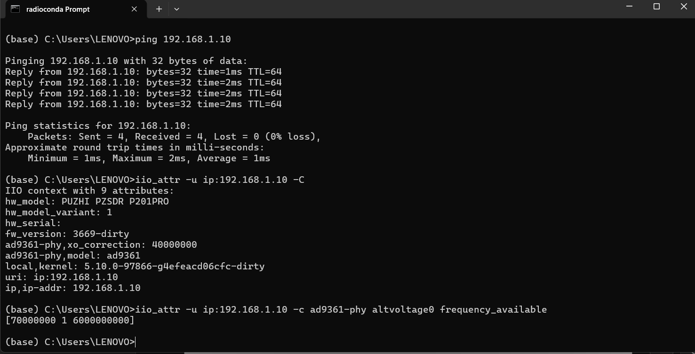

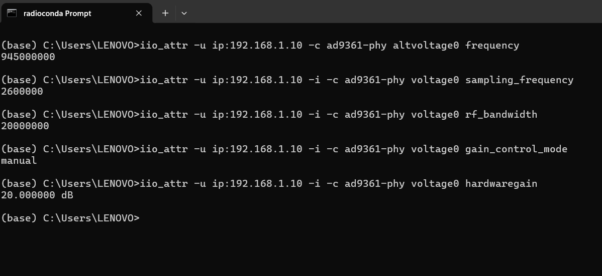

در دریافت هوایی طبق دستور کار آنتن روی RX1 و فرستنده بدون آنتن است. آزمون حلقه باید با کابل TX1 به RX1، بهرهٔ RX حداکثر ۱۰ dB و تضعیف TX حداقل ۴۰ dB انجام شود. اتصال فیزیکی و تضعیف واقعی از این تصاویر به‌تنهایی قابل تأیید نیست. فلوگراف موجود سقف بهرهٔ حلقه را ۱۰ و کف تضعیف را ۴۰ dB قرار داده است؛ مقدار اولیهٔ تضعیف در فایل ۶۹ dB است.

جاروب واقعی بهره در ضبط‌های 944.53 MHz و 20 MS/s شامل 0، 5، 10، 15، 20، 25 و 30 dB است؛ یک ضبط جداگانهٔ 24 dB نیز موجود است. در بیشترین بهرهٔ آزموده‌شده، 30 dB، بیشینهٔ |I|=0.3535 و |Q|=0.3413 است و هیچ نمونه‌ای از 0.5 عبور نمی‌کند. بنابراین 30 dB معیار دستور کار را در همین ضبط برآورده می‌کند؛ نتیجه برای سیگنال و زمان دیگر تضمین نیست.

## ۲. نخستین طیف و دو بلوک پهن

در ثبت باریک ۲٫۶ MS/s، سیگنال پهن بخش بزرگی از نما را پر کرده و شبیه یک کف بالاتر دیده می‌شود؛ بنابراین از این نما نمی‌توان حامل‌های GSM را با اطمینان شمرد. در نمای ۲۰ MS/s دو بلوک با لبه‌های نسبتاً تیز و فرورفتگی میان آن‌ها آشکار می‌شود. نام فایل GSMcarriers به‌تنهایی تشخیص GSM نیست.

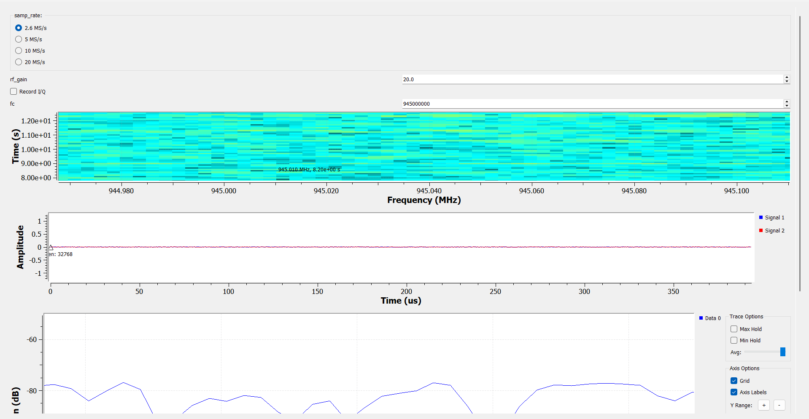

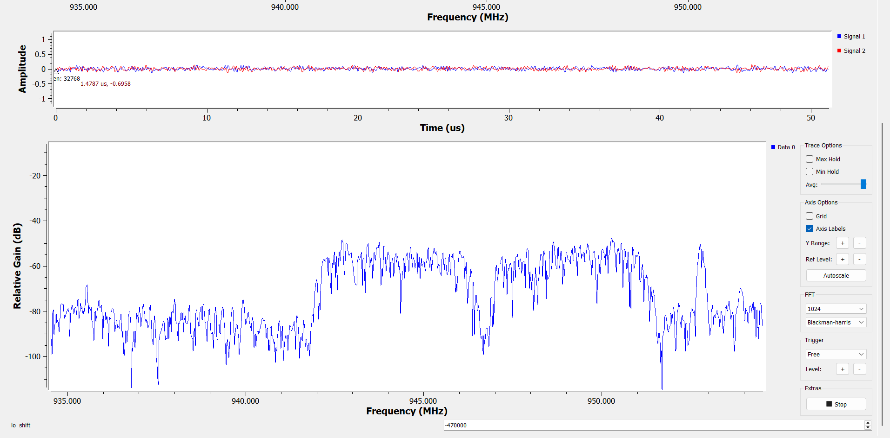

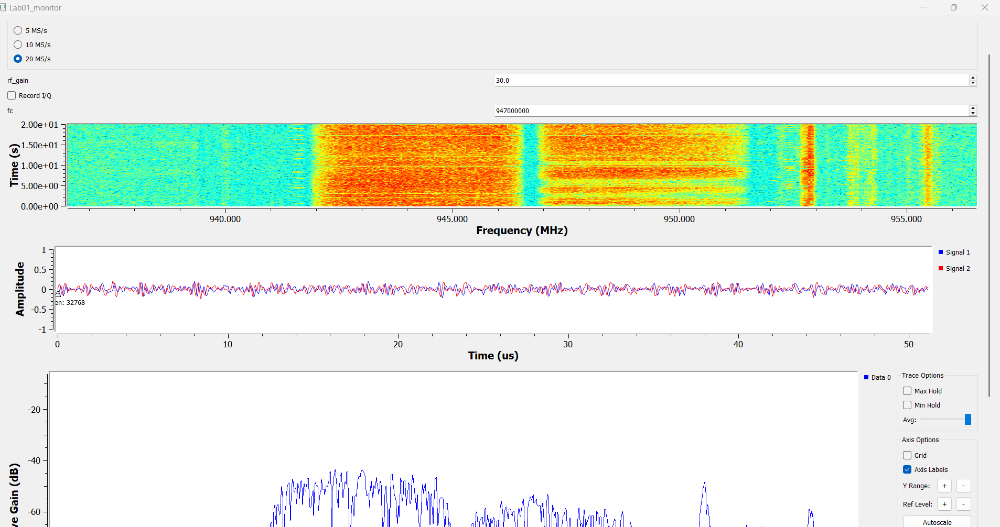

در P3_radio_2 محور فرکانس حدود ۹۳۳ تا ۹۵۳ MHz است. خوانش چشمی لبه‌ها، بلوک اول را تقریباً ۹۴۲ تا ۹۴۶٫۵ و بلوک دوم را تقریباً ۹۴۷ تا ۹۵۱٫۵ MHz نشان می‌دهد: مراکز هندسی حدود ۹۴۴٫۲۵ و ۹۴۹٫۲۵ MHz و عرض ظاهری هرکدام حدود ۴٫۵ MHz. عدم قطعیت خوانش تصویر دست‌کم حدود ۰٫۲ MHz است؛ این عرض، B6 یا B20 یا OBW99 اندازه‌گیری‌شده نیست. نزدیکی به عرض فعال LTE پنج‌مگاهرتزی و لبه‌های تیز، فرضیهٔ LTE را تقویت می‌کند، ولی UMTS یا ترکیب سیگنال‌ها با این مدرک به‌طور قطعی رد نمی‌شود [۳،۴].

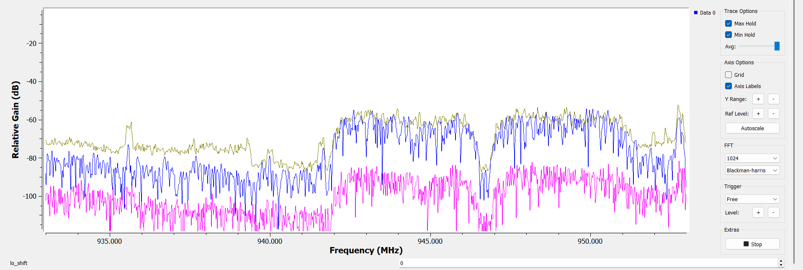

## ۳. آزمون حلقه، علامت فرکانس و جابه‌جایی LO

در فایل GRC موجود، فرکانس TX برابر int(fc)، فرکانس RX و محور هر دو برابر f_tune=int(fc+lo_shift) و فرکانس تن برابر f_tx است. با fc=434 MHz و f_tx=+250 kHz، انتظار تن در 434.25 MHz است. تصاویر تن قوی نزدیک این مقدار و با تغییر علامت، تن نزدیک 433.75 MHz را نشان می‌دهند.

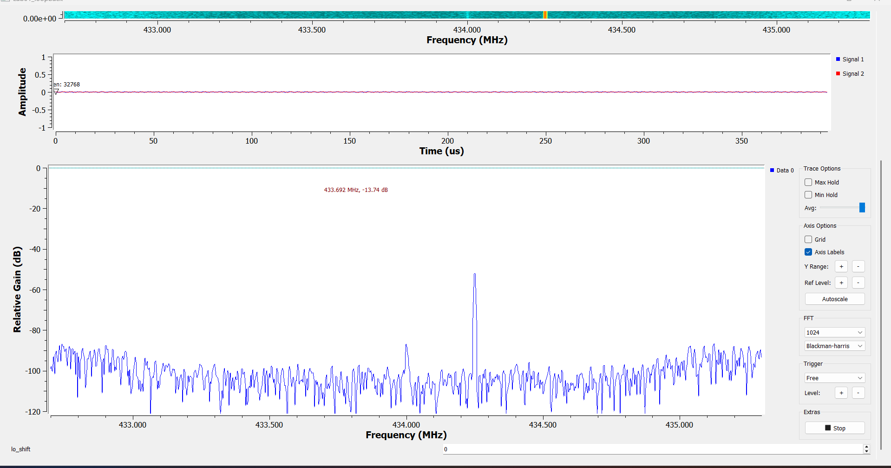

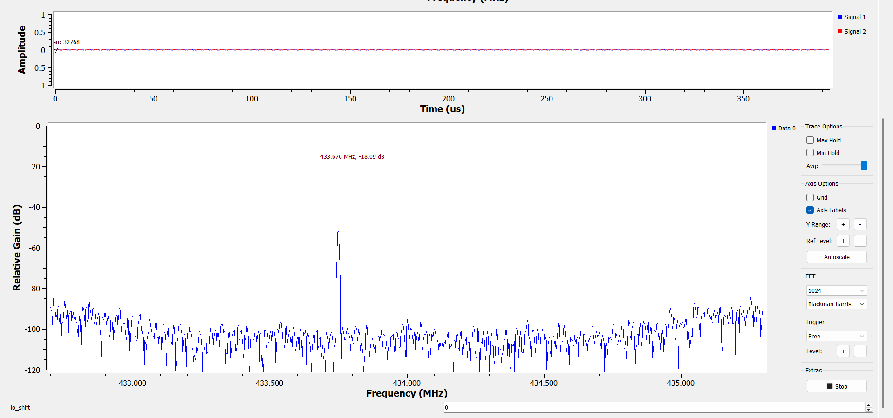

| lo_shift (kHz) | تن واقعی (MHz) | DC گیرنده (MHz) | تصویر RX از تن (MHz) |
| --- | --- | --- | --- |
| `−100` | `434.250` | `433.900` | `433.550` |
| `0` | `434.250` | `434.000` | `433.750` |
| `+100` | `434.250` | `434.100` | `433.950` |
| `+200` | `434.250` | `434.200` | `434.150` |

انتظار تئوری آزمون LO برای تن مثبت؛ این جدول اندازه‌گیری قله‌ها نیست

در تصاویر lo_shift=+100، +200 و −100، قلهٔ اصلی نزدیک ۴۳۴٫۲۵ تا ۴۳۴٫۳۰ MHz باقی می‌ماند؛ پس مشاهدهٔ کیفی با ثابت‌ماندن RF تن سازگار است. چند قلهٔ جانبی هم دیده می‌شود، اما همهٔ آن‌ها با الگوی سادهٔ DC یا تصویر آینه‌ای RX در جدول بالا منطبق نیستند. به‌خصوص جابه‌جایی بعضی قله‌های جانبی بزرگ‌تر از انتظار است. آن‌ها را بدون بازخوانی هم‌زمان RX LO، TX LO و نرخ، «حامل واقعی» یا «نشتی مشخص» نام‌گذاری قطعی نمی‌کنیم.

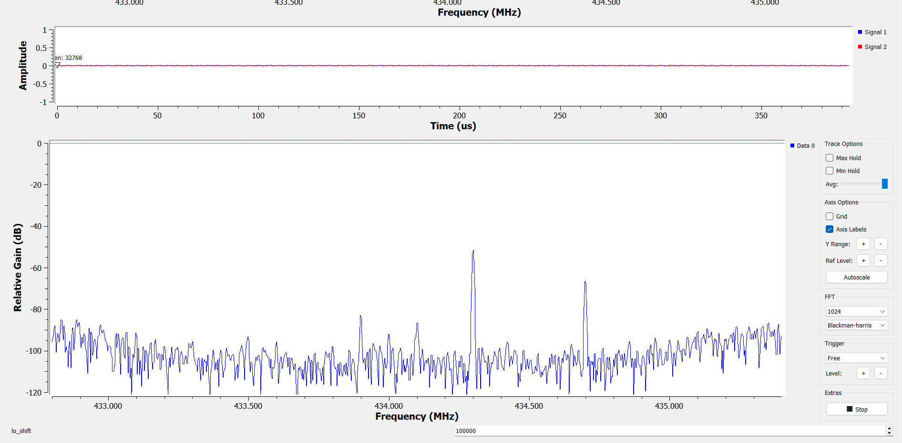

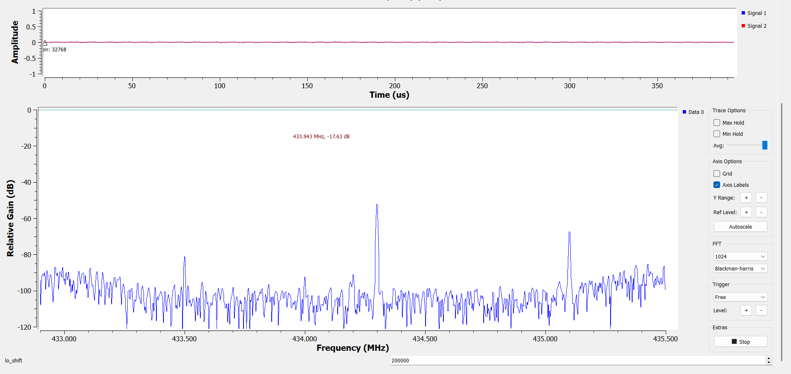

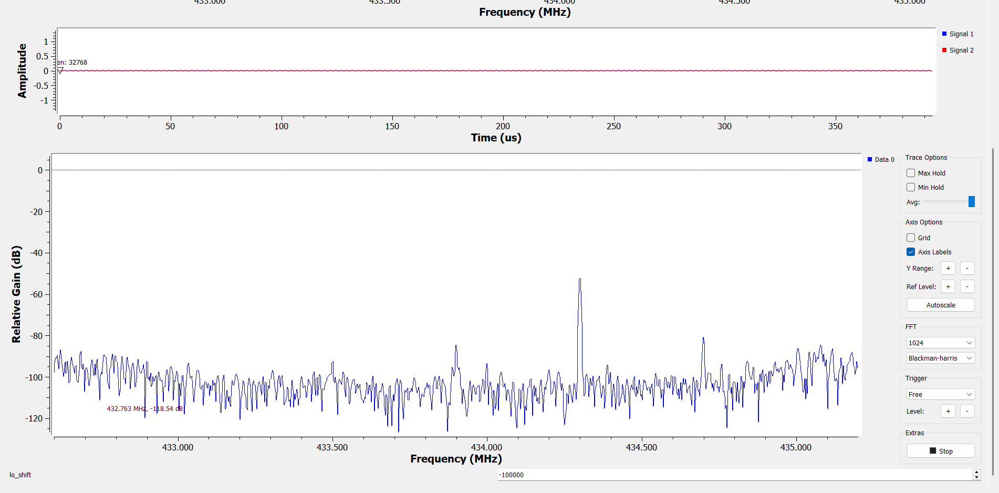

در P2_DCoff محور به حوالی ۹۴۵ MHz تغییر کرده است؛ با این تصویر نمی‌توان افزایش قله را به خاموش‌شدن تصحیح DC در ۴۳۴ MHz نسبت داد. برای مقایسهٔ معتبر، باید دو ثبت با fc، fs، بهره، تضعیف و اتصال یکسان و فقط تغییر گزینه‌های DC فراهم شود.

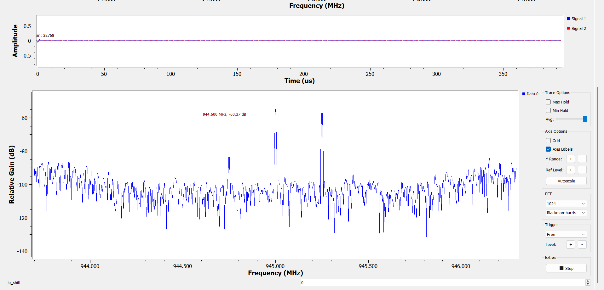

بازتحلیل IQ، تن پایهٔ مثبت را 434249999.97 Hz و منفی را 433750000.03 Hz می‌دهد. سه ضبط جابه‌جایی LO تن نزدیک 434299999.5 تا 434299999.9 Hz دارند؛ این اختلاف واقعی با تن پایه در جدول عددی ثبت شده است. در مقایسهٔ +100 و +200 kHz، DC با شیب تقریباً 1 و تن اصلی با شیب تقریباً صفر حرکت می‌کند؛ قلهٔ جانبی 434.70 به 435.10 MHz شیب تقریباً 4 دارد و با تصویر سادهٔ گیرنده با شیب 2 منطبق نیست. تغییر هم‌زمان تنظیمات یا مرتبهٔ بالاتر اعوجاج باید در تکرار آزمون بررسی شود.

## ۴. پویش، ریموت و فراسوی تلفن

طبق دستور کار، در ۲۰ MS/s فقط بخش مرکزی ۱۶ MHz معتبر فرض می‌شود. برای فروسو مراکز ۹۴۳ و ۹۵۹ و برای فراسو ۸۹۸ و ۹۱۴ MHz لازم‌اند. تصاویر موجود پوشش همهٔ گام‌ها را اثبات نمی‌کنند. در نمای فراسو حدود ۹۰۴ تا ۹۲۴ MHz، تنها بخش داخل باند ۸۹۰ تا ۹۱۵ برای این تمرین فراسوی GSM900 است؛ قله‌های بالاتر از ۹۱۵ MHz را به این سرویس نسبت نمی‌دهیم.

در باند ریموت، تصویر خاموش عمدتاً کف طیف را نشان می‌دهد و تصویر روشن یک قلهٔ گذرا نزدیک ۴۳۳٫۹ MHz ثبت می‌کند. فاصلهٔ زیاد Max Hold از منحنی لحظه‌ای نشانهٔ رویدادی است که در قاب فعلی حضور ندارد. شکل، با ریموت OOK/FSK سازگار است؛ تمایز این دو مدولاسیون و شمارش بسته‌ها از این تصاویر ممکن نیست. قله‌ها و دامن پهن در ثبت ۲۰ MS/s می‌توانند اثر غیرخطی یا تداخل هم باشند و پهنای واقعی ریموت محسوب نمی‌شوند.

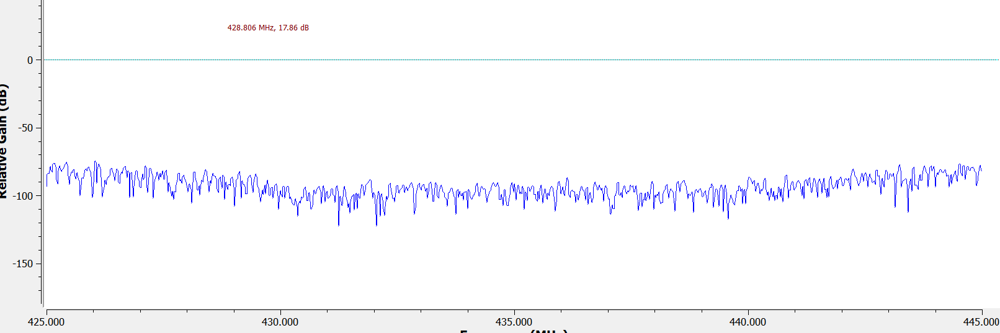

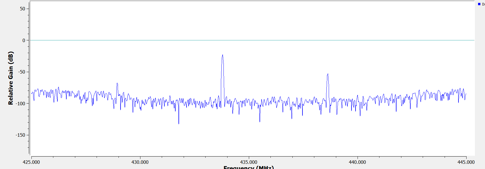

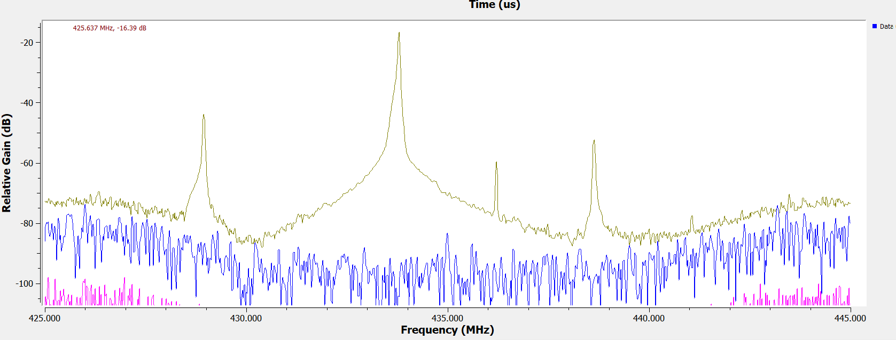

پس از تماس، Max Hold در حوالی ۹۰۷ تا ۹۰۹ و نزدیک ۹۱۱٫۶ MHz افزایش‌هایی را ثبت کرده که در نمای بدون تماس به این قوت دیده نمی‌شوند. آبشار نیز رگه‌های زمانی محدود نشان می‌دهد. این شواهد با ارسال برستی تلفن سازگارند؛ اتصال فقط نسل دو و وابستگی دقیق هر قله به تلفن گروه در مدارک تأیید نشده است.

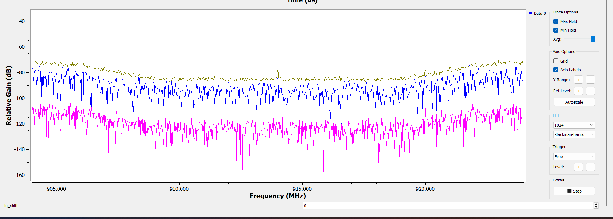

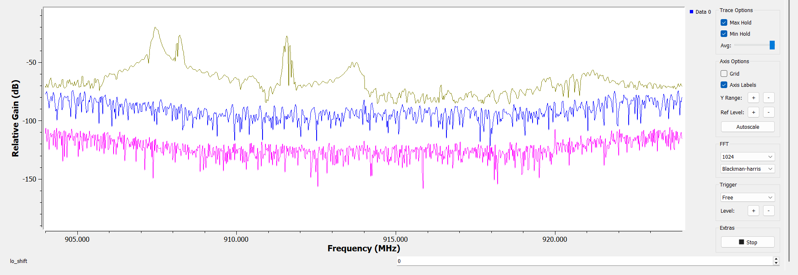

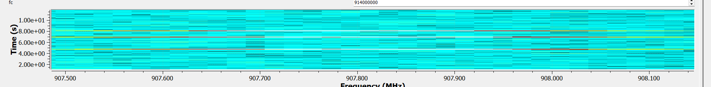

## ۵. فهرست سیگنال‌ها و پیش‌بینی در برابر مشاهده

پنج سیگنال زیر از محیط و در سه محدودهٔ ریموت، فروسوی سلولی و فراسوی سلولی انتخاب شده‌اند. سیگنال حلقه در این شمارش نیست. مرکز گزارش‌شده، وسط دو مرز B99 است؛ مرکز شبکهٔ حامل GSM در بخش ppm جداگانه تعیین می‌شود. تمام فرکانس‌ها برچسب اسمی گیرنده و پیش از تصحیح ppm هستند.

| سیگنال / فایل | مرکز B99 | B99 | Bx / x |
| --- | --- | --- | --- |
| بلوک فروسو A / R16 | 944.171454 | 4162.13 | 4531.43 / 20 dB |
| بلوک فروسو B / R16 | 949.132506 | 4107.77 | 4492.77 / 20 dB |
| حامل باریک GSM / R22 | 952.801181 | 264.50 | 265.22 / 20 dB |
| ریموت / R07 | 433.787430 | 28.16 | 12.94 / 20 dB |
| رویداد فراسو / R08 | 899.524016 | 3579.77 | 3535.89 / 6 dB |

پنج سیگنال اندازه‌گیری‌شده از IQ؛ واحد مرکز MHz و پهنا kHz است

| فایل / fs (MS/s) | fL / fU (MHz) | قله (dB/Hz) | رفتار |
| --- | --- | --- | --- |
| R16 / 20.0 | 941.924948 / 946.456381 | -84.46 | ماندگار در ضبط 0.5 s |
| R16 / 20.0 | 946.927231 / 951.420003 | -89.98 | ماندگار در ضبط 0.5 s |
| R22 / 20.0 | 952.668964 / 952.934183 | -86.24 | برست‌های باریک در حامل |
| R07 / 2.6 | 433.784279 / 433.797218 | -56.17 | بسته‌های تکراری |
| R08 / 20.0 | 897.708962 / 901.244857 | -107.20 | گذرای 56.1 تا 61.2 ms |

مرزهای بیرونی Bx و تنظیمات؛ سطح قلهٔ میانگین نسبی بر Hz است

برای جلوگیری از رقیق‌شدن رویداد فراسو در نویز، PSD اندازه‌گیری آن روی پنجرهٔ فعال 0.0561 تا 0.0612 s محاسبه شده؛ آبشار همچنان کل ضبط 0.5 s را نمایش می‌دهد. B99 آن حدود 3.580 MHz و B6 حدود 3.536 MHz است. چند خط باریک پایدار در باند، از جمله نزدیک 900 MHz، وجود دارند؛ انتساب این رویداد به یک تلفن خاص یا فناوری خاص بدون لاگ هم‌زمان ممکن نیست.

ریموت در این ضبط نزدیک 433.79 MHz است؛ عدد 433.92 MHz در بخش تصویری، انتظار باند و خوانش تقریبی قبلی است. اختلاف حدود 130 kHz به خطای ppm دستگاه نسبت داده نمی‌شود، زیرا مرجع فرکانس فرستندهٔ ریموت معلوم نیست. سیگنال از مرکز ضبط 435 MHz حدود 1.21 MHz فاصله دارد و بیرون از محدودهٔ مرکزی 80٪ یعنی 433.96 تا 436.04 MHz است. B99 آن اندازه‌گیری همین ضبط و متأثر از پاسخ لبه است؛ تکرار با مرکز نزدیک 433.79 MHz برای اندازه‌گیری مطمئن‌تر لازم است.

پیش‌بینی کیفی دو بلوک با پیکربندی LTE پنج‌مگاهرتزی سازگار است: 25 RB × 180 kHz = 4.5 MHz [۳]. اختلاف B20 مشاهده‌شده با این پهنای فعال حدود 0.70٪ برای A و 0.16٪ برای B است؛ این مقایسهٔ دو تعریف متفاوت پهنا، خطای رسمی انطباق استاندارد نیست. B99 به بار شبکه و توزیع توان وابسته است و با پهنای اسمی 5 MHz یکسان گرفته نمی‌شود. شکل طیف به‌تنهایی فناوری را قطعی نمی‌کند.

شبکهٔ فاصلهٔ حامل GSM برابر 200 kHz است؛ این مقدار، پهنای اشغالی نیست. B99 حامل انتخابی حدود 264.5 kHz به‌دست آمده و به ROI و نویز وابسته است. برای ریموت مشخصهٔ پهنای سازنده و برای رویداد فراسو هویت قطعی در دست نیست؛ در نتیجه درصد خطای ساختگی نسبت به یک مرجع نامعلوم گزارش نمی‌شود. پیش‌گزارش قبلی جدول عددی پیش‌بینی نداشته و مقایسهٔ حاضر پس از مشاهدهٔ داده است. برای FM نیز فایل قابل‌انتساب به باند صحیح موجود نیست.

## ۶. پاسخ پرسش‌های ۱ تا ۸

پرسش ۱ — لبه‌ها و گام پویش: پاسخ فیلتر آنالوگ و دیجیتال در لبه‌ها افت می‌کند؛ بنابراین قسمت مرکزی تقریباً ۸۰٪ پهنای fs مبنای پویش است. در fs=20 MS/s، بخش معتبر fc±8 MHz و گام 16 MHz است. نماهای کامل ۲۰٪ هم‌پوشانی دارند و بازه‌های مرکزی معتبر به هم می‌رسند. برای fs=2.6 MS/s، پهنای معتبر تقریبی 2.08 MHz است.

پرسش ۲ — شبکهٔ GSM و ppm: در ضبط 959 MHz، سه حامل اسمی 952.8، 953.8 و 955.4 MHz با n=89، 94 و 102 از رابطهٔ 935+n×0.2 MHz انتخاب شدند. برست‌های تن نزدیک f_carrier+1625000/24 Hz با FCCH سازگارند [۶]. میانهٔ باقیماندهٔ تن‌ها به‌ترتیب +2083، +2066 و +2077 Hz است؛ با فرض مرجع مستقل ایستگاه و مرجع مشترک RX LO و ADC، ε=(f_nominal/f_label−1)×10⁶ حدود −2.18 ppm می‌شود. پراکندگی درون هر حامل 28 تا 36 Hz، حدود 0.03 تا 0.04 ppm است؛ این فقط تکرارپذیری الگوریتم است و خطای مرجع ایستگاه، فیلتر و طبقه‌بندی FCCH را پوشش نمی‌دهد. کانال‌های 89 و 94 نامزد BCCH هستند؛ بدون بازیابی SCH/BCCH تأیید محتوایی و هویت شبکه انجام نشده است.

پرسش ۳ — علامت فرکانس: نمونهٔ مختلط x=I+jQ جهت چرخش فاز را نگه می‌دارد؛ exp(+j2πft) و exp(−j2πft) در دو سمت صفر باندپایه قرار می‌گیرند. با تنها شاخهٔ I، هر دو به cos(2πft) تبدیل می‌شوند و علامت قابل تمایز نیست؛ طیف حقیقی زوج است. در حلقه، این دو حالت به‌ترتیب نزدیک 434.25 و 433.75 MHz دیده می‌شوند.

پرسش ۴ — شیب حرکت قله: s=Δf_label/Δf_RXLO. برای RF ثابت در RX1، s≈0؛ برای DC باندپایهٔ گیرنده، s≈1. نشتی TX LO یا تصویر تولیدشده در فرستنده نیز سیگنال RF واقعی در ورودی RX است و با ثابت‌بودن TX، s≈0 دارد. تصویر ناشی از عدم توازن IQ در گیرنده در f_image=2f_RXLO−f_RF قرار می‌گیرد و s≈2 دارد؛ بنابراین تقسیم سادهٔ صفر و یک برای همهٔ قله‌ها کافی نیست. در ضبط‌های LO، تن اصلی نزدیک 434.30 MHz ثابت، DC متحرک با شیب 1 و یک قلهٔ جانبی با شیب حدود 4 مشاهده می‌شود. بنابراین همهٔ قله‌ها با مدل DC/تصویر ساده توضیح داده نمی‌شوند؛ اعداد در بخش IQ آمده‌اند.

پرسش ۵ — چرا حلقه خطای مرجع را پنهان می‌کند؟ در یک دستگاه، LO فرستنده، LO گیرنده و نرخ DAC/ADC از مرجع مشترک مشتق می‌شوند. اگر همه با عامل 1+ε مقیاس شوند، تن RF حلقه برابر (fc+f_tx)(1+ε) و فرکانس دیجیتال دریافتی با همان عامل تقسیم می‌شود؛ برچسب تقریباً fc+f_tx باقی می‌ماند. ایستگاه بیرونی مرجع مستقل دارد و خطا آشکار می‌شود. پس درست‌بودن برچسب حلقه، کالیبراسیون مطلق فرکانس را ثابت نمی‌کند.

پرسش ۶ — پیوسته و گذرا: بلوک‌های پهن فروسو در آبشار ماندگارترند؛ ریموت و فعالیت مرتبط با تماس گذراترند. Max Hold بیشینهٔ هر خانه را در طول مشاهده نگه می‌دارد و رد سیگنال غایب در قاب فعلی را نشان می‌دهد. برای استنتاج دقیق، پس از تغییر فرکانس یا بهره حافظه پاک و میانگین‌گیری None انتخاب می‌شود؛ جمع قله‌های غیرهم‌زمان یک سیگنال پهن هم‌زمان نیست.

پرسش ۷ — رهگیری برست ریموت: تحلیل 3.8461538 s نمونه، 2473 فاصلهٔ روشن OOK و با ادغام فاصله‌های خاموش کوتاه‌تر از 8 ms، 32 گروه بسته می‌دهد؛ آخرین گروه بریده و 31 گروه کامل است. مدت میانهٔ گروه کامل 89.1 ms و فاصلهٔ شروع‌ها 105.0 ms است. با T_N=1024/2.6e6≈0.394 ms و T_u فرضی 100 ms، مدل فاز شروع یکنواخت P≈min(1,(T_N+T_b)/T_u) احتمال هم‌پوشانی حدود 89.5٪ برای یک بسته می‌دهد. برای پالس منفرد میانهٔ 0.8 ms همین تقریب حدود 1.19٪ است. این احتمال نظری با نسبت تجربی رهگیری زنده برابر نیست؛ تعداد فشردن دکمه و شمار مشاهدهٔ زنده ثبت نشده است. آبشار آفلاین تمام قاب‌های نمونه را به کار می‌گیرد، ولی افت نمونهٔ احتمالی هنگام دریافت از فایل بدون timestamp قابل اثبات یا رد نیست.

پرسش ۸ — UMTS در برابر LTE پنج‌مگاهرتزی بدون دمدولاسیون: ابتدا با نرخ دست‌کم 6.25 MS/s، پهنای RF کافی، بهرهٔ بدون اشباع و وضوح مناسب، PSD میانگین و آبشار یک حامل جداشده را بسازید. پهنا به‌تنهایی کافی نیست: UMTS با نرخ تراشهٔ 3.84 Mcps و فیلتر شکل‌دهنده معمولاً شانه‌های گردتری دارد؛ LTE با ۲۵ RB لبهٔ فعال حدود 4.5 MHz و شکل تخت‌تر دارد [۳،۴]. تغییرات زمانی و مرزهای تیز قرینه‌اند، نه اثبات. در دادهٔ IQ، هم‌بستگی تأخیری با فاصلهٔ مفید نماد OFDM یعنی حدود 66.67 µs و تکرار ساختار CP، بدون بازیابی بیت، شاهد قوی‌تری برای LTE با فاصلهٔ زیرحامل 15 kHz می‌دهد [۵]. چند ویژگی را هم‌زمان و پس از حذف تداخل بررسی می‌کنیم؛ در این نسخه Welch و آبشار واقعی موجود است؛ آزمون هم‌بستگی CP و دمدولاسیون اجرا نشده و تشخیص LTE همچنان احتمالی است.

## ۷. تحلیل عددی، ضبط و بودجهٔ عدم قطعیت

اکنون ۲۲ فایل cf32 با حجم مجموع 1.4198 GB بررسی شده‌اند. همهٔ حجم‌ها مضرب 8 و همهٔ نمونه‌ها متناهی‌اند. فایل مشاهده‌شده در کنسول با پایان 091550 در مجموعهٔ فعلی موجود نیست؛ با ضبط‌های موجود جایگزین‌نام‌گذاری نشده است. تعداد نمونه، مدت اسمی، مرکز، نرخ، بهره، زمان نام فایل و SHA-256 برای هر فایل در manifest.json ثبت شده است. زمان‌ها ساعت محلی تأییدشده نیستند و مدت از شمار نمونه و نرخ اسمی حاصل می‌شود.

| منبع | کمّی‌سازی |
| --- | --- |
| تفکیک FFT با N=1024 | در 2.6 MS/s: Δf=2.5390625 kHz؛ در 20 MS/s: Δf=19.53125 kHz |
| کوانتیزهٔ انتخاب خانهٔ قله | اگر فقط نزدیک‌ترین خانه خوانده شود: حدود ±Δf/2؛ پنجره، SNR و بایاس نیز مؤثرند |
| خطای پهنا از دو لبه | حد بدبینانه از خطای خانه‌ها حدود ±Δf؛ دقت واقعی به شیب لبه و کف نویز هم وابسته است |
| مرجع فرضی ±25 ppm | در 434 MHz: ±10.85 kHz؛ در 945 MHz: ±23.625 kHz؛ مشخصهٔ قطعی دستگاه فعلی نیست |
| خوانش بلوک‌ها از تصویر | حدود ±0.2 MHz یا بیشتر؛ برای B99، B6/B20 یا ppm کافی نیست |
| انتقال فایل cf32 | ۸ بایت/نمونه؛ 2.6 MS/s یعنی 20.8 MB/s و 20 MS/s یعنی 160 MB/s؛ نرخ فایل مدت دیواری را تضمین نمی‌کند |

مقیاس‌های خطا؛ این مقادیر حد تضمین‌شدهٔ کل اندازه‌گیری نیستند

پردازش تحویلی از cf32 با ترتیب I,Q و little-endian استفاده می‌کند، میانگین Welch را در مقیاس خطی و با پنجرهٔ Hann می‌سازد و پس از آن به dB تبدیل می‌کند. برای هر سیگنال باید بازهٔ جداگانهٔ RF انتخاب شود؛ انتگرال‌گیری روی کل باند چندحاملی پهنای یک سیگنال نیست. B99 از صدک‌های تجمعی ۰٫۵٪ و ۹۹٫۵٪ در همان بازه به دست می‌آید؛ نتیجه با کف نویز موجود محاسبه می‌شود و وابستگی آن به ROI در خروجی ثبت می‌شود. سطح PSD با واحد توان نسبی بر Hz است؛ بدون کالیبراسیون، dBm نیست و در صورت نامعلوم‌بودن مقیاس نمونه‌ها، dBFS نامیده نمی‌شود.

آبشار آفلاین از تمام نمونه‌ها در قاب‌های پی‌درپی ساخته می‌شود؛ برای تصویر نهایی قاب‌ها گروه‌بندی می‌شوند و حداقل/حداکثر زمان هر گروه حفظ می‌شود. یک فایل فاقد timestamp یا شمارندهٔ سخت‌افزار نمی‌تواند نبود نمونه‌های ازدست‌رفته در شبکه را ثابت کند. اندازه‌گیری برست با مسیر جداگانهٔ توان کانال و گام زمانی ۰٫۱ ms انجام می‌شود؛ آستانه باید از قطعهٔ خاموش انتخاب و حساسیت نتیجه به آن بررسی شود. حذف گذرای فیلتر در ابتدای فایل و علامت‌زدن رویداد بریده در انتها ضروری است.

تحلیل جلسه با session_analysis.py روی ۲۲ فایل پوشهٔ recordings اجرا شد. نتایج عددی results.json و فهرست manifest.json همراه کد و نمودارها منتشر شده‌اند. به علت حجم زیاد فایل های IQ تنها دو فایل به عنوان نمونه بارگزاری شده اند. دو نمونهٔ اصلی آزمون حلقه از بخش فایل‌ها قابل دانلودند؛ سایر ضبط‌ها از مجموعهٔ حدود 1.42 GB در پوشهٔ محلی نگهداری می‌شوند. SHA-256 امکان تطبیق نسخهٔ خام را فراهم می‌کند. دستور بازتولید و وابستگی‌ها در راهنمای تحلیل قرار دارد.

## ۸. عیب‌یابی و کارهایی که بار بعد تغییر می‌دهیم

خطای نصب یا قطع اتصال از تصاویر اثبات نشده است؛ ping موفق است. مسائل مستند تحلیل عبارت‌اند از نام‌گذاری گمراه‌کنندهٔ radio، تغییر محور در DCoff، lo_shift غیرصفر در بخشی از ثبت‌ها و نبود دفتر شمارش برست‌ها. پیام‌های U/O یا نویسه‌های تکراری کنسول به‌تنهایی مقدار افت داده را تعیین نمی‌کنند و باید همراه با نسخهٔ نرم‌افزار و شمارنده‌های انتقال تفسیر شوند.

- همراه هر ضبط، RX LO و TX LO، نرخ واقعی، بهره، تضعیف، حالت DC/IQ، اتصال، پنجره، FFT و زمان شروع را در JSON ثبت می‌کنیم؛ پس از هر تغییر حافظهٔ Max Hold را پاک می‌کنیم.
- برای پهنای چندمگاهرتزی نرخ کافی و برای زمان‌بندی برست نرخ 2.6 MS/s با کنترل افت نمونه انتخاب می‌کنیم؛ ضبط باریک جای نمای کامل سیگنال پهن را نمی‌گیرد.
- در آزمون LO، یک جدول هم‌زمان برای همهٔ قله‌ها و حداقل سه مقدار شیفت ثبت می‌کنیم؛ DC روشن/خاموش را با تنظیم و اتصال یکسان می‌سنجیم.
- تعداد فشردن ریموت و زمان هرکدام را با شمارنده ثبت می‌کنیم و کلیپ صوتی/ویدئو را جای ساعت نمونهٔ IQ نمی‌گیریم.
- برای آزمون اشباع، بهره را ۵ تا ۱۰ dB کم می‌کنیم و تغییر نسبی قله‌های اصلی و جانبی و دامنهٔ نمونه‌ها را مقایسه می‌کنیم.

## ۹. نتایج بازتحلیل فایل‌های واقعی IQ

پردازش Welch با Hann و هم‌پوشانی 50٪، N=16384 در 20 MS/s و N=8192 در 2.6 MS/s انجام شد؛ Δf به‌ترتیب 1220.70 و 317.38 Hz است. میانگین در مقیاس خطی محاسبه شده است. B99 صدک‌های 0.5٪ و 99.5٪ توان در ROI است؛ نویز کم نشده است. Bx فاصلهٔ بیرونی‌ترین عبورهای آستانه در بیشینهٔ قاب‌هاست و فرورفتگی داخلی را دربر می‌گیرد. نتیجهٔ صرفاً متصل به یک قله نیز برای ممیزی در JSON ذخیره شده است.

x از معیار عملی قله/کف طیفی انتخاب شد: اگر نسبت قلهٔ Max Hold به صدک 20٪ کف کل باند حداقل 26 dB بود x=20 وگرنه x=6. این نسبت با SNR انتگرالی کالیبره یکسان نیست؛ برای رویداد ضعیف فراسو x=6 انتخاب شد. Max Hold آفلاین با Hann و FFT بزرگ‌تر از تنظیم زندهٔ Blackman-Harris است؛ اختلاف کوچک با خوانش زنده انتظار می‌رود. سطح‌ها نسبی‌اند و به dBm تبدیل نشده‌اند.

| سیگنال | ROI | B99 با ROI اصلی | ROI کوچک/بزرگ |
| --- | --- | --- | --- |
| بلوک فروسو A | 941.850–946.650 | 4.1621 | 4.0928 / 4.1673 |
| بلوک فروسو B | 946.850–951.650 | 4.1078 | 4.0302 / 4.1136 |
| حامل باریک GSM | 952.600–953.000 | 0.2645 | 0.2620 / 0.2677 |
| ریموت | 433.720–433.880 | 0.0282 | 0.0276 / 0.0286 |
| رویداد فراسو | 897.700–901.400 | 3.5798 | 3.2784 / 3.8016 |

بازهٔ انتگرال‌گیری و حساسیت B99 به انتخاب ROI؛ واحد MHz است

در جدول حساسیت، پهنای ROI به‌ترتیب 10٪ کاهش و افزایش یافته است؛ تغییر بزرگ برای حامل GSM و سیگنال کم‌دوام فراسو نشان می‌دهد برآورد B99 به نویز و انتخاب بازه حساس است. ارقام چاپ‌شده دقت محاسباتی‌اند؛ حد تضمین خطا نیستند. خطای مرز FFT، پاسخ فیلتر، آستانه و خطای محور باید همراه نتیجه در نظر گرفته شوند.

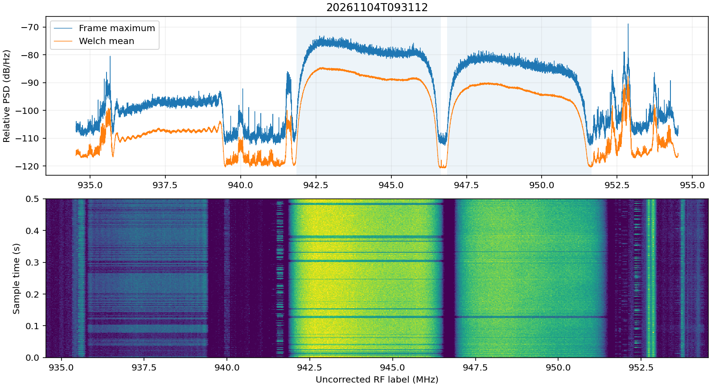

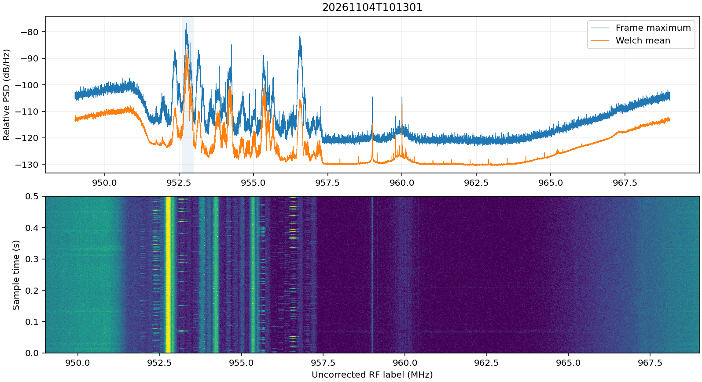

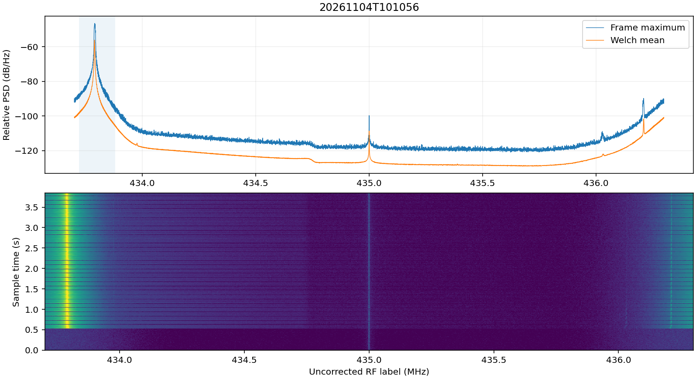

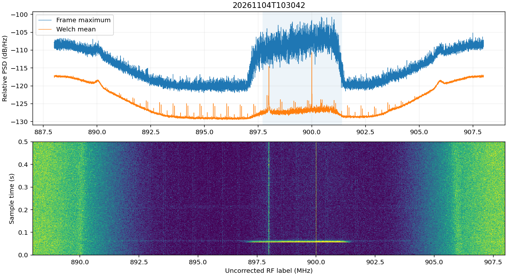

| زمان فایل | RX (MHz) | تن برآوردی (MHz) | اختلاف با فرض ±250 kHz (Hz) |
| --- | --- | --- | --- |
| 094843 | 434.000 | 433.75000003 | 0.03 |
| 095024 | 434.000 | 434.24999997 | -0.03 |
| 095058 | 434.100 | 434.29999986 | 49999.86 |
| 095210 | 434.200 | 434.29999978 | 49999.78 |
| 095435 | 433.900 | 434.29999950 | 49999.50 |

تخمین زیرخانه‌ای حلقه با 1048576 نمونه و فاصلهٔ خانهٔ 2.4796 Hz

برآورد تن، FFT با پنجرهٔ Hann و درون‌یابی سهموی لگاریتم سه خانهٔ قله است. خطای حدود ±0.03 Hz در دو حالت پایه با اشتراک مرجع TX/RX سازگار است و صحت مطلق فرکانس را ثابت نمی‌کند. اختلاف حدود +50 kHz در سه ضبط LO چندین مرتبه از گام FFT بزرگ‌تر است؛ لاگ هم‌زمان f_tx و TX LO موجود نیست و علت تغییر تنظیم قابل تعیین نیست. برازش تن سه ضبط جابه‌جایی، شیب بسیار نزدیک صفر می‌دهد؛ مقایسهٔ آن‌ها با تن پایه نباید به‌عنوان آزمون تنظیم ثابت انجام شود.

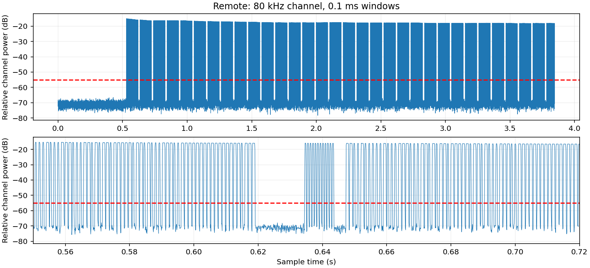

| آستانه (dB) | پالس / گروه کامل | مدت میانه (ms) | دورهٔ میانه (ms) |
| --- | --- | --- | --- |
| -58 | 2473 / 31 | 89.1 | 105.0 |
| -55 | 2473 / 31 | 89.1 | 105.0 |
| -52 | 2473 / 31 | 89.1 | 105.0 |

حساسیت تشخیص ریموت به آستانه؛ فاصلهٔ ادغام بسته 8 ms است

اولین پالس حدود 0.5296 s است؛ کف کانال در قطعهٔ خاموش آغاز فایل حدود −71.2 dB و آستانه حدود 16 dB بالاتر از آن است. تغییر آستانه به اندازهٔ ±3 dB شمار پالس و بسته و میانهٔ مدت/دوره را تغییر نمی‌دهد؛ لبه‌ها و مدت پالس ممکن است یک گام 0.1 ms جابه‌جا شوند. از 32 گروه، آخری نزدیک انتهای فایل است و محافظه‌کارانه از آمار مدت کامل حذف شده است. گروه‌بندی بر پایهٔ فاصلهٔ خاموش 8 ms، یک تعریف عملی است و رمزگشایی پروتکل انجام نشده است.

| بهره (dB) | مدت (s) | max |I| | max |Q| |
| --- | --- | --- | --- |
| 0 | 0.446 | 0.0190 | 0.0229 |
| 5 | 0.500 | 0.0288 | 0.0312 |
| 10 | 0.500 | 0.0464 | 0.0454 |
| 15 | 0.500 | 0.0801 | 0.0830 |
| 20 | 0.500 | 0.1069 | 0.1094 |
| 24 | 0.500 | 0.2275 | 0.2300 |
| 25 | 0.500 | 0.1743 | 0.1680 |
| 30 | 0.500 | 0.3535 | 0.3413 |

جاروب بهره در 944.53 MHz؛ بیشینهٔ کل فایل با معیار 0.5 مقایسه می‌شود

| حامل / n | تعداد برست | باقیمانده / σ (Hz) | مرجع (ppm) |
| --- | --- | --- | --- |
| 952.8 / 89 | 10 | 2083.4 / 35.7 | -2.186 |
| 953.8 / 94 | 14 | 2066.0 / 35.9 | -2.166 |
| 955.4 / 102 | 10 | 2077.4 / 27.8 | -2.174 |

برآورد مشروط FCCH؛ پراکندگی، انحراف معیار برست‌های آشکارشده است

برآورد FCCH پس از جداسازی هر کانال و تبدیل نرخ به 1.083333 MS/s انجام شده است. نسبت توان نوار باریک 8 kHz پیرامون تن مورد انتظار به توان کانال باید از 0.65 بیشتر و مدت آن دست‌کم 0.15 ms باشد؛ یک پنجره از هر لبه حذف و میانگین اختلاف فاز نمونه‌های مجاور استفاده می‌شود. این آشکارساز بدون بازیابی بیت است؛ برست‌های مشاهده‌شده حدود 0.25 تا 0.55 ms و باقیماندهٔ نزدیک +2.1 kHz دارند. مقدار −2.18 ppm نتیجه‌ای مشروط به درست‌بودن تشخیص و شبکهٔ فرکانسی است، نه گواه کالیبراسیون آزمایشگاهی.

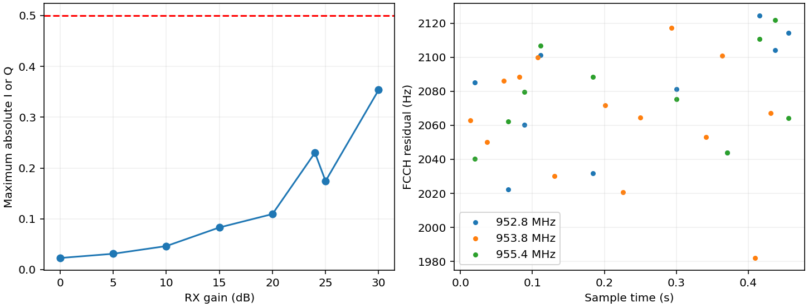

## ۱۰. وضعیت تحویل و شواهد

| الزام | نتیجه |
| --- | --- |
| پنج سیگنال در سه محدوده | جدول اندازه‌گیری مستقل، مرزها، نرخ و شناسهٔ فایل ارائه شد؛ محدودیت لبهٔ ریموت مشخص است. |
| Welch، B99، Bx و نمودار کدنویسی | از IQ واقعی محاسبه و همراه کد و خروجی عددی منتشر شد. |
| ریموت و زمان برست | 32 گروه، 31 کامل، مدت 89.1 ms و دوره 105.0 ms؛ نسبت رهگیری زنده به دلیل نبود شمارش دکمه قابل محاسبه نیست. |
| حلقه و LO | تن پایه، تخمین زیرخانه‌ای و اختلاف 50 kHz در ضبط‌های LO گزارش شد. |
| GSM، ppm و BCCH | سه نامزد حامل، برآورد مشروط −2.18 ppm و نامزدهای BCCH شمارهٔ 89 و 94؛ محتوای BCCH رمزگشایی نشده است. |
| بهره و مستندات ضبط | جاروب 0 تا 30 dB، بررسی همهٔ نمونه‌ها، SHA-256 و دستور بازتولید موجود است. |
| لاگ و مقایسه با پیش‌گزارش | زمان‌ها از نام فایل و تنظیمات اسمی بازسازی شد؛ شمار فشردن، تقسیم کار و جدول عددی پیش‌بینی قبلی موجود نیست. |
| فایل‌های همراه | GRC، ضبط‌کننده، کد تحلیل، نتایج، شکل‌ها و PDF پیوست‌اند؛ دو فایل خام نمونه قابل دانلودند؛ باقی مجموعهٔ 1.42 GB محلی نگهداری می‌شود. |

وضعیت پس از پردازش دادهٔ خام

## پیوست تصویری: سایر ثبت‌های جلسه

ثبت‌های تکمیلی با نام و محتوای اصلی نگهداری شده‌اند.

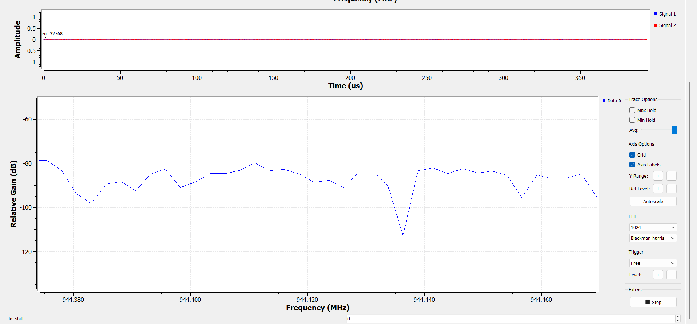

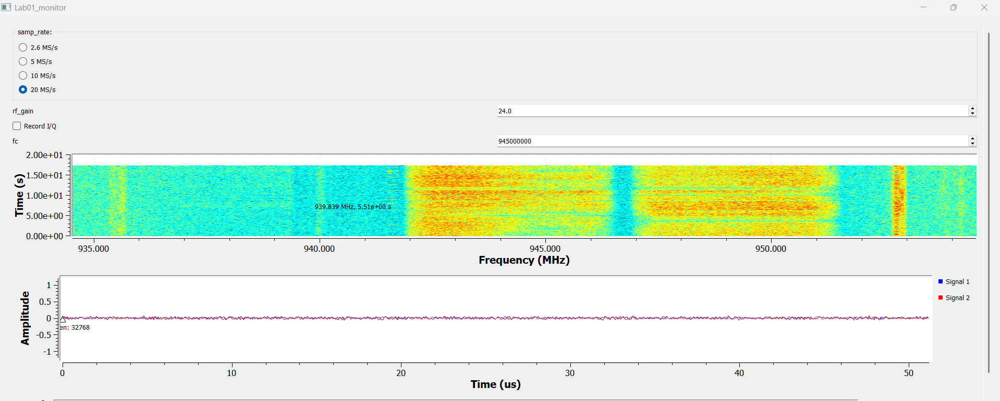

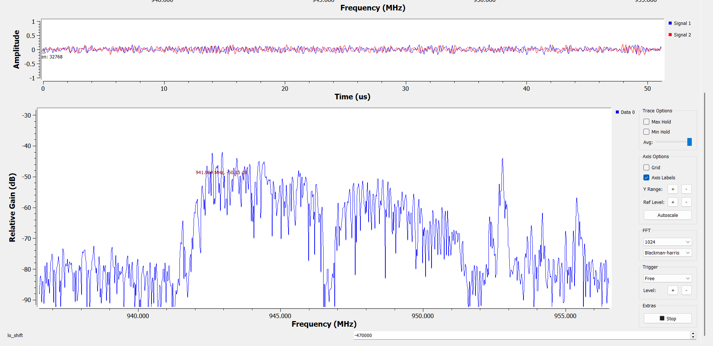

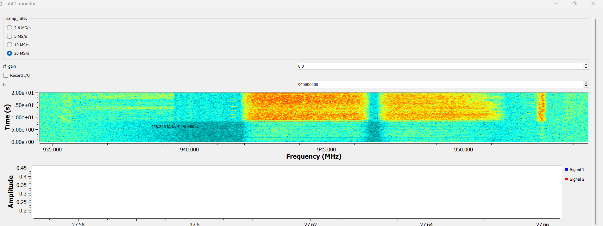

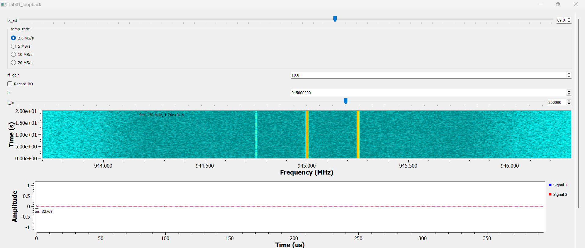

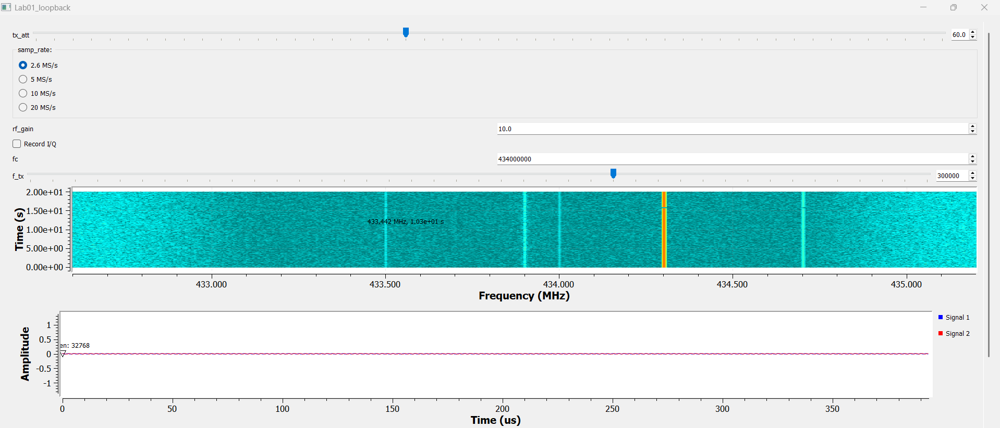

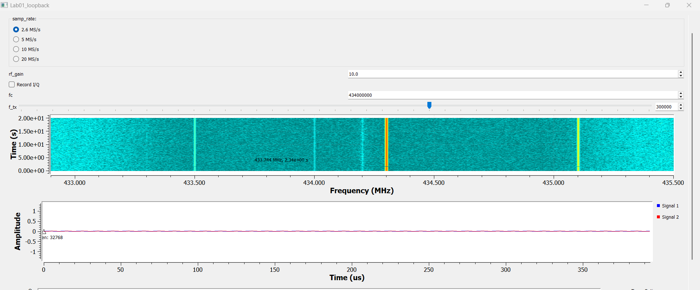

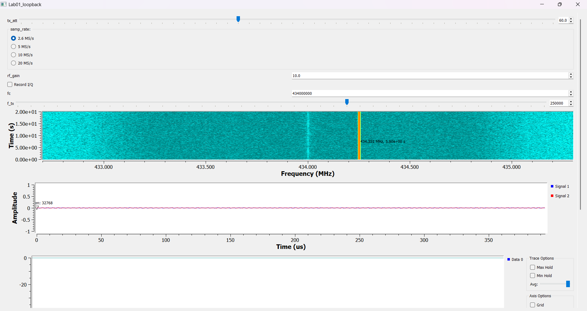

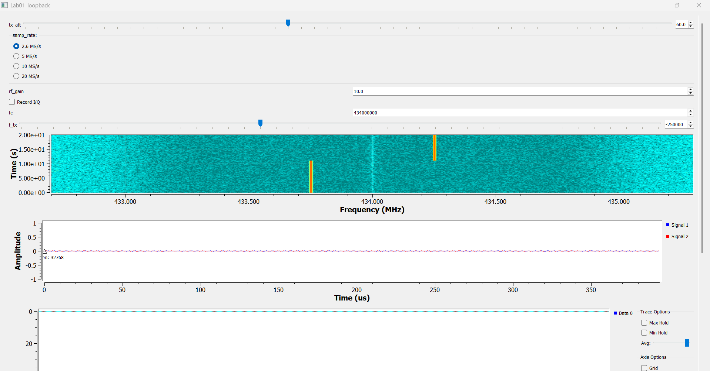

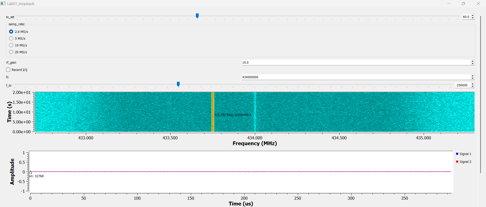

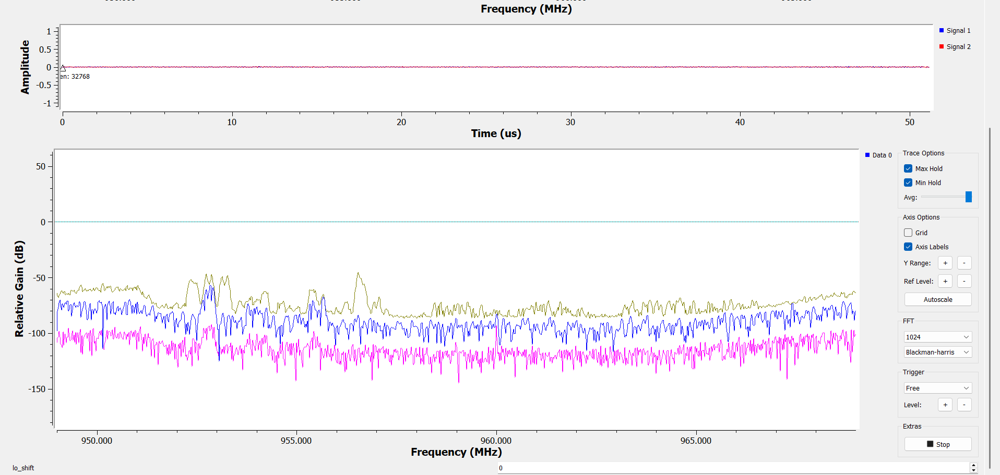

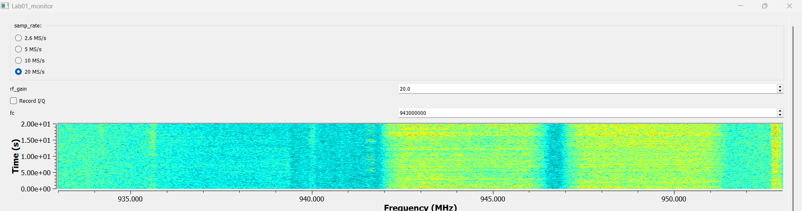

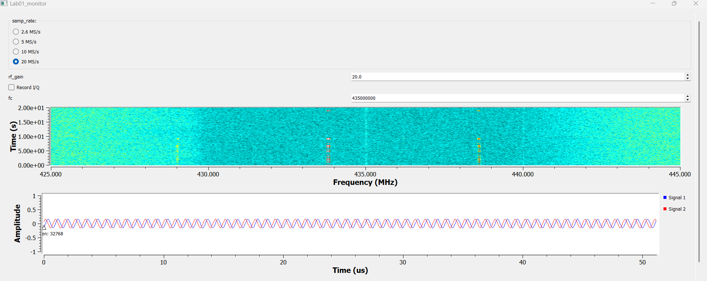

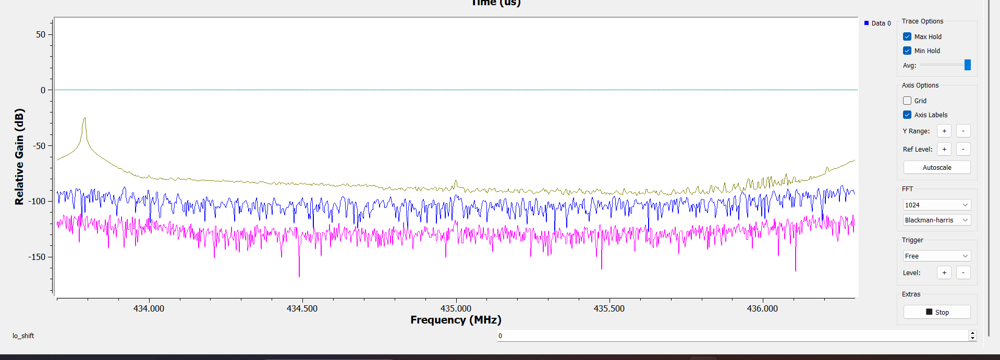

## ۱۱. فایل‌ها و اجرای تحلیل

به علت حجم زیاد فایل های IQ تنها دو فایل به عنوان نمونه بارگزاری شده اند

- [متن قابل ویرایش گزارش](../../reports/lab01-post/report.md)
- [دستور کار آزمایش ۱](../../downloads/lab01/lab01-manual.pdf)
- [کد تحلیل آفلاین IQ](../../code/lab01/analyze_iq.py)
- [لاگ بازسازی‌شدهٔ جلسه](../../reports/lab01-post/log.md)
- [فلوگراف پایش موجود](../../reports/lab01-prelab/Lab01_monitor.grc)
- [فلوگراف حلقهٔ موجود](../../reports/lab01-prelab/Lab01_loopback.grc)
- [ضبط‌کنندهٔ موجود](../../reports/lab01-prelab/SDRLab_IQ_recorder.py)
- [راهنمای تحلیل و نام فایل‌های IQ](../../reports/lab01-post/IQ-README.md)
- [کد تحلیل جلسه](../../code/lab01/session_analysis.py)
- [نتایج کامل عددی](../../data/lab01/session/results.json)
- [فهرست و SHA-256 ضبط‌ها](../../data/lab01/session/manifest.json)
- [نمونهٔ IQ اول: تن منفی حلقه](../../downloads/lab01/iq/Ghalami_Momeni_lab01_434000000_2600000_10.0_20261104T094843.cf32)
- [نمونهٔ IQ دوم: آزمون جابه‌جایی LO](../../downloads/lab01/iq/Ghalami_Momeni_lab01_434100000_2600000_10.0_20261104T095058.cf32)

راهنمای تحلیل و جدول نام فایل‌ها در reports/lab01-post/IQ-README.md قرار دارد. شناسه‌های R01 تا R22 در آن به نام کامل فایل و SHA-256 ارجاع دارند. نتایج و فهرست داده در data/lab01/session و نمودارها در assets/images/lab01/iq هستند.

## مراجع

[۱] دستور کار آزمایش ۱: پایش طیف، lab_01_spectrum_final (2).pdf، ۱۹ صفحه؛ پرسش‌ها در صفحات ۹–۱۵، الزامات تحلیل در صفحهٔ ۱۵.
[۲] photos.zip، شامل ۳۷ تصویر اصلی ثبت‌شدهٔ گروه؛ اعداد مشاهده‌ای با نام تصویر در متن مشخص شده‌اند.
[۳] ETSI TS 136 104 V18.5.0، جدول 5.6-1: پهنای کانال و تعداد RB. https://www.etsi.org/deliver/etsi_TS/136100_136199/136104/18.05.00_60/ts_136104v180500p.pdf
[۴] ETSI TS 125 104 V3.8.0، بخش‌های ۵٫۱ و ۵٫۴٫۱: نرخ تراشه و فاصلهٔ کانال UTRA FDD. https://www.etsi.org/deliver/etsi_ts/125100_125199/125104/03.08.00_60/ts_125104v030800p.pdf
[۵] ETSI TS 136 211 V15.8.1، ساختار نماد OFDM و CP. https://www.etsi.org/deliver/etsi_ts/136200_136299/136211/15.08.01_60/ts_136211v150801p.pdf
[۶] پیاده‌سازی مرجع gr-gsm، receiver_impl.cc، محاسبهٔ اختلاف فاز FCCH و نرخ نماد 1625000/6؛ مبنای تن یک‌چهارم نرخ نماد. https://github.com/ptrkrysik/gr-gsm/blob/master/lib/receiver/receiver_impl.cc
